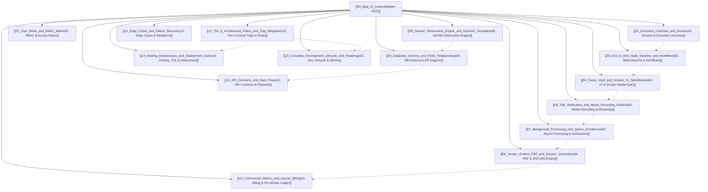

# 🗺️ Master Map of Content (MOC)
### Motor Claim Verification & Dossier Intelligence Platform

Welcome to the central knowledge hub for the **Motor Claim Verification & Dossier Intelligence Platform**. This collection of interlinked Obsidian documents provides an end-to-end, production-ready specification designed so that any software engineer, architect, or product manager can implement, test, deploy, and operate the platform with zero external dependencies.

---

## 🧭 Vault Navigation & Knowledge Graph

---

## 📚 Document Index & Modules

| # | Document | Primary Focus | Key Entities / Concepts |
|---|---|---|---|
| **01** | [[01_Executive_Overview_and_Domain]] | High-level system context, problem statement, business goals | Commercial vs. LMV claims, fraud mitigation, tele-verification |
| **02** | [[02_User_Roles_and_RBAC_Matrix]] | Persona isolation, permission matrix, route guards | Admin, Manager (QA), Agent, Insurer Client Portal |
| **03** | [[03_End_to_End_State_Machine_and_Workflows]] | Lifecycle state machine, validation triggers, transitions | `UNASSIGNED`, `WIP`, `REVIEW`, `ADMIN SIGN-OFF`, `COMPLETED` |
| **04** | [[04_Cases_Vault_and_Dossier_UI_Specification]] | Detailed UI specifications, 7-section Dossier Modal | Data grid, filters, aging pill, callback timers, modal forms |
| **05** | [[05_Database_Schema_and_Entity_Relationships]] | Complete PostgreSQL DDL, ER diagram, JSONB columns | Tables: `cases`, `contacts`, `recordings`, `documents`, `dossiers` |
| **06** | [[06_Tele_Verification_and_Media_Recording_Pipeline]] | In-browser media recording, WhatsApp Web deep links | Direct media recording, forced buffer flush, dual audio mixing, snapshots |
| **07** | [[07_Background_Processing_and_Queue_Architecture]] | Asynchronous background architecture, 202 Accepted pattern | In-memory Goroutines (optional Asynq/Redis), on-the-fly SHA-256, PDF generation |
| **08** | [[08_Dossier_Observation_Engine_and_Dynamic_Templates]] | 10 mandatory observation fields, repudiation taxonomy | JSONB schema, validation engine, Heavy vs. Light vehicle templates |
| **09** | [[09_Tamper_Evident_PDF_and_Dossier_Generation]] | Cryptographically verified PDF reports for court/insurer | Chromium/typst, SHA-256 hash stamp, IST time display, QR codes |
| **10** | [[10_Commercial_Metrics_and_Insurer_Billing]] | Financial billing ledger, exact per-minute calculation | Integer seconds storage, rate cards, invoice generation, reconciliation |
| **11** | [[11_The_6_Architectural_Pillars_and_Trap_Mitigations]] | 6 non-negotiable architectural mandates from Day 1 | Storage abstraction, buffer flush & direct upload, worker isolation, stateless Go, SSL/CORS, UTC |
| **12** | [[12_API_Contracts_and_Data_Flows]] | RESTful endpoint specifications & payload contracts | Idempotency keys, auth headers, status codes, JSON models |
| **13** | [[13_Edge_Cases_and_Failure_Recovery]] | Comprehensive edge case mitigation guide | Wi-Fi drops, tab crash, mic denial, recall timers, tamper alerts |
| **14** | [[14_Hosting_Infrastructure_and_Deployment_Guide]] | Production & Demo infrastructure, SSL, Nginx, Docker | Let's Encrypt SSL (`getUserMedia`), MinIO/S3, Docker Compose, .env spec |
| **15** | [[15_Complete_Development_Lifecycle_and_Roadmap]] | Phased developer implementation roadmap (Phases 0–6) | Setup, Core API, Media Engine, Dossier, Worker, QA, Staging Demo |

---

## ⚡ The 6 Non-Negotiable Core Rules (Quick Reference)

Before writing any code, every developer must review [[11_The_6_Architectural_Pillars_and_Trap_Mitigations]]:

1. **Storage Abstraction Trap**: Never write to local disk directly. Implement the `StorageProvider` interface (`UploadFile`, `GetSignedURL`) with local MinIO for demo and S3/R2 for cloud.
2. **Media Recording Buffer Flush & Direct Upload**: Slicing 5s chunks and active Redis recovery was dropped due to scale (~100 agents max; 5s chunking created high HTTP traffic, network fragmentation, and stitching overhead). Use continuous in-memory slice buffering (`recorder.start(500)`), forced buffer flush via `recorder.requestData()` on stop, non-zero file validation, and clean direct upload.
3. **Background Job Isolation**: Never run PDF generation or intensive hashing synchronously in HTTP request threads. Return `202 Accepted` and offload asynchronously to Go goroutines (or optional worker queue).
4. **Stateless Go Server**: Zero server-side state or sessions in memory. Use JWT auth and PostgreSQL/database for state; 100% config driven by `.env`.
5. **CORS & Media API SSL Mandate**: `navigator.mediaDevices` APIs strictly require HTTPS in production (browsers only allow HTTP on localhost). Staging demos require SSL (Let's Encrypt).
6. **Timezones & Call Runtime Precision**: Always store timestamps in UTC (`TIMESTAMPTZ`) and durations in raw integer seconds. Render in Indian Standard Time (IST / UTC+05:30) only at display/PDF time.

---

## 🎯 Role-Based Reading Paths

### 💻 For Frontend Engineers
1. Start with [[04_Cases_Vault_and_Dossier_UI_Specification]] to understand the Case Vault and the 7-section Dossier Modal.
2. Study [[06_Tele_Verification_and_Media_Recording_Pipeline]] for WhatsApp integration, permanent floating call widgets, audio capture, and direct upload mechanics.
3. Review [[08_Dossier_Observation_Engine_and_Dynamic_Templates]] for dynamic JSONB form validation.
4. Check [[12_API_Contracts_and_Data_Flows]] for payload structures and endpoints.

### ⚙️ For Backend / Go Engineers
1. Study [[11_The_6_Architectural_Pillars_and_Trap_Mitigations]] thoroughly.
2. Review [[05_Database_Schema_and_Entity_Relationships]] for table definitions and migrations.
3. Implement [[07_Background_Processing_and_Queue_Architecture]] for asynchronous job execution, on-the-fly SHA-256 calculation, and PDF dossier compilation.
4. Build the endpoints specified in [[12_API_Contracts_and_Data_Flows]].
5. Implement [[09_Tamper_Evident_PDF_and_Dossier_Generation]] and [[10_Commercial_Metrics_and_Insurer_Billing]].

### 🚢 For DevOps & Infrastructure Engineers
1. Read [[14_Hosting_Infrastructure_and_Deployment_Guide]] for Docker Compose, Nginx SSL, MinIO, and PostgreSQL setup.
2. Read Rule 5 of [[11_The_6_Architectural_Pillars_and_Trap_Mitigations]] regarding HTTPS requirements for browser media APIs.
3. Follow the infrastructure phases in [[15_Complete_Development_Lifecycle_and_Roadmap]].

---

> [!TIP]
> Use Obsidian's **Graph View** (`Ctrl+G` / `Cmd+G`) to visualize how these 15 documents link together to form a complete architectural blueprint.
