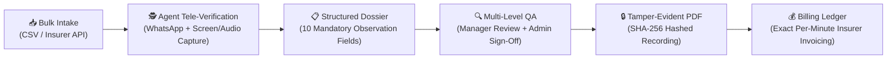
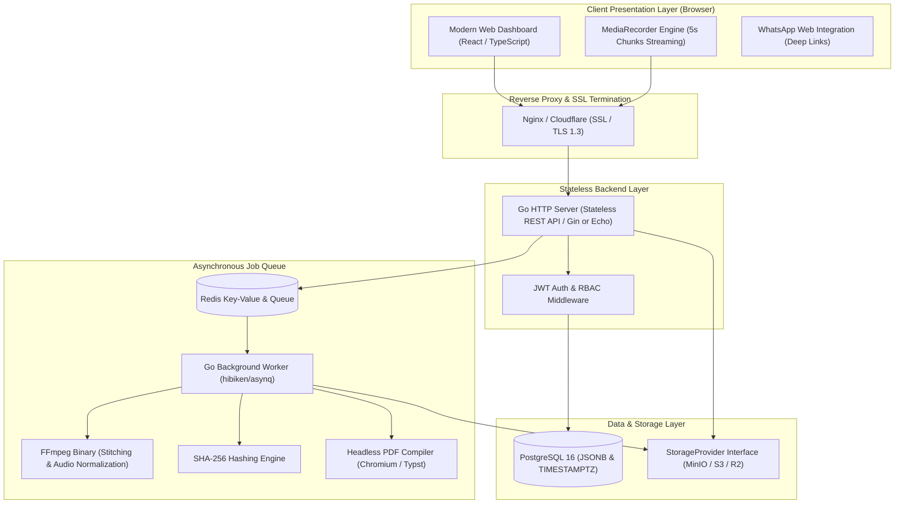

# 🏢 01. Executive Overview & Business Domain

## 1. Domain Context & Industry Problem

In the Indian General Insurance landscape, motor vehicle claims—especially for **Commercial / Heavy Goods Vehicles (HGV)** and **Light Motor Vehicles (LMV)**—represent the single largest category of both claims volume and fraudulent leakages. 

### Common Fraud Patterns Detected During Claim Investigation
1. **Driver Substitution / "Implant"**: A non-licensed or intoxicated driver crashes the vehicle; the owner later reports an insured driver with a valid commercial badge to avoid claim repudiation.
2. **Old / Pre-Existing Damages (OD Claims)**: Passing off dents and chassis bends from past un-insured incidents as damages from the latest accidental event.
3. **Staged Third-Party (TP) Accidents**: Collusion between insured and third-party claimants with compromised First Information Reports (FIR) or General Diary (GD) entries.
4. **Commercial Permit & Overloading Breaches**: Heavy commercial trucks operating without valid state/national permits, fitness certificates, or carrying tonnage far exceeding the Gross Vehicle Weight (GVW).
5. **Fabricated Garage Estimates**: Inflated repair bills prepared in collusion with local garages.

### The Legacy Operational Bottleneck
Historically, Third-Party Investigation Agencies (TPAs) and Insurance Surveyors relied on manual paper files, personal WhatsApp calls on investigators' smartphones, and unverified summaries:
- **No Chain of Custody**: Audio and video evidence was stored on personal phones and often deleted or compressed, making it inadmissible in court or dispute arbitration.
- **Unverifiable Billable Hours**: Investigators billed insurers on estimated call minutes without tamper-evident call duration logs.
- **Data Fragmentation**: Driving licenses (DL), Registration Certificates (RC), police papers, and call recordings existed in separate email threads and chat backups.
- **Lack of Standardized Observations**: Reports lacked consistent investigative rigor across different vehicle types.

---

## 2. Platform Core Objective & Value Proposition

The **Motor Claim Verification & Dossier Intelligence Platform** is a centralized, multi-tenant web platform that standardizes the entire investigation lifecycle into a continuous digital chain of custody:

### Key Capabilities
* **In-Browser Screen & Audio Tele-Verification**: Initiates a WhatsApp Web session directly while recording the agent's screen and call audio in 5-second resilient chunks without requiring desktop third-party software.
* **Tamper-Evident Evidence Vault**: Generates cryptographic SHA-256 hashes of all concatenated audio/video recordings and embeds them into locked PDF dossiers.
* **Dynamic Vehicle-Class Observations**: Uses PostgreSQL JSONB to support distinct observation requirements for Commercial Heavy Vehicles (permits, weighbridge slips) and Light Motor Vehicles.
* **Per-Minute Accurate Commercial Ledger**: Stores call runtimes down to the exact second in UTC, converting to billable minutes automatically to eliminate client billing disputes.

---

## 3. High-Level System Architecture

The platform follows a modern, decoupled, cloud-ready architecture:

---

## 4. Key Architectural Standards

To ensure production stability, the platform enforces 6 foundational principles from Day 1 (detailed in [[11_The_6_Architectural_Pillars_and_Trap_Mitigations]]):

1. **Storage Abstraction Interface**: Zero hardcoded local filesystem paths (`StorageProvider` interface for Local, MinIO, S3, R2).
2. **Chunked Media Recording**: Browser streams 5-second audio/video slices; no single-blob RAM explosions.
3. **Asynchronous Background Isolation**: FFmpeg video stitching and PDF compilation run strictly in background workers via Redis; HTTP handlers return `202 Accepted` immediately.
4. **Stateless Backend**: Zero server-side state in memory; 100% config driven by environment variables (`.env`).
5. **Strict HTTPS / SSL Requirement**: Media devices (`getUserMedia` and `getDisplayMedia`) mandate HTTPS in any staging or production environment.
6. **Timezone Precision (UTC vs IST)**: Timestamps stored in UTC (`TIMESTAMPTZ`) and durations in raw seconds; formatted to IST (UTC+05:30) only at display/PDF time.

---

## 5. Next Steps & Connected Knowledge

* To understand who uses the platform and what permissions they hold, continue to [[02_User_Roles_and_RBAC_Matrix]].
* To see how a claim progresses through its operational lifecycle, review [[03_End_to_End_State_Machine_and_Workflows]].
* For database schema design and JSONB dynamic templates, jump to [[05_Database_Schema_and_Entity_Relationships]].
