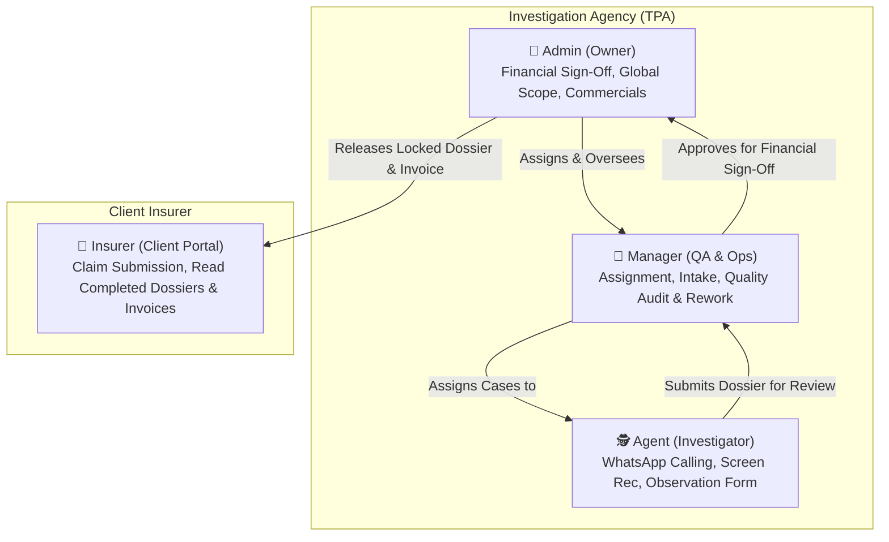

# 👥 02. User Roles and RBAC Permission Matrix

## 1. Persona Definitions

The platform enforces strict role-based access control (RBAC) and data isolation across 4 distinct user personas:



### 1. Admin (Owner / Managing Director)
* **Scope**: Global system visibility across all tenants, teams, agents, and insurers.
* **Responsibilities**: Configuration of commercial billing rates, operational rate cards per insurer, final financial sign-off on completed investigations, managing user credentials, and viewing executive profitability analytics.
* **Restrictions**: None.

### 2. Manager (QA Lead & Operations Supervisor)
* **Scope**: Regional or team-level visibility; can inspect all cases assigned to their managed agents.
* **Responsibilities**: Intake of new claim batches via Bulk CSV/Excel or manual entry; assignment and load-balanced reassignment of cases to agents; auditing submitted observation forms and call recordings; approving cases or rejecting them back to WIP with specific rework instructions.
* **Restrictions**: Blocked from viewing commercial rate cards, profit margins, and insurer invoicing calculations.

### 3. Agent (Field / Tele-Verification Investigator)
* **Scope**: Strictly limited to their currently assigned active cases (`assigned_agent_id == user.id`).
* **Responsibilities**: Reviewing policy details and suspicious triggers; initiating WhatsApp Web tele-verification sessions with synchronized screen/audio recording; setting callback recall timers; uploading supplemental evidence documents (RC, DL, FIR, garage estimates); accurately populating the 10 mandatory observation fields (*); submitting completed dossiers for review.
* **Restrictions**: Cannot reassign cases, cannot view cases assigned to peers, cannot delete recordings, cannot view commercial metrics, and cannot bypass mandatory observation validations.

### 4. Insurer (Client Representative / Claims Manager)
* **Scope**: Tenant-isolated view strictly limited to claims originating from their insurance company (`insurer_id == user.insurer_id`).
* **Responsibilities**: Submitting individual or bulk claims; monitoring live case progress status counters; viewing and downloading final locked tamper-evident PDF dossiers; reviewing certified call recordings and SHA-256 verification hashes; accessing per-minute billing reports and monthly invoices.
* **Restrictions**: Cannot view internal agent notes, QA rework history, agent performance stats, or other insurers' claims.

---

## 2. Granular Permissions & Capabilities Matrix

| Feature / System Module | Admin (Owner) | Manager (QA & Ops) | Agent (Investigator) | Insurer (Client Portal) |
| :--- | :---: | :---: | :---: | :---: |
| **Commercial Metrics & Rates** | Full Read/Write | ❌ Blocked | ❌ Blocked | View Own Invoices Only |
| **Bulk CSV / Manual Case Intake** | Full Access | Full Access | ❌ Blocked | Submit Claims Only |
| **Cases Vault (Main Data Grid)** | Global View (All Cases) | Team / Regional View | Assigned Queue Only | Own Completed Cases |
| **Agent Assignment / Rebalance** | Any Agent | Team Agents Only | ❌ Read-Only | ❌ Blocked |
| **Screen & Call Recorder Access** | Audit / Playback | Audit / Playback | Primary Execution | View Final Master Link |
| **Observation Form (* Fields)** | Edit / Override | Review / Flag Errors | Fill & Submit | Read-Only (Inside PDF) |
| **Quality Review & Approval** | Final Sign-Off | Approve / Reject to WIP | Rework Rejected Cases | Request Re-open Only |
| **Final Dossier PDF Export** | Full Access | Operational Export | ❌ Blocked | Download Certified PDF |
| **Raw Recording Deletion** | ❌ Soft-delete only (Audit logged) | ❌ Blocked | ❌ Blocked | ❌ Blocked |
| **Audit Log Trail Inspection** | Full Access | Team Audit Only | ❌ Blocked | ❌ Blocked |

---

## 3. Backend RBAC Enforcement Pattern (Go)

Authentication uses stateless JWT tokens containing the user's ID, Role, and Tenant/Insurer ID. Authorization is enforced via composable Go middleware:

```go
package middleware

import (
    "net/http"
    "github.com/gin-gonic/gin"
    "github.com/golang-jwt/jwt/v5"
)

type UserClaims struct {
    UserID    string `json:"user_id"`
    Role      string `json:"role"` // ADMIN, MANAGER, AGENT, INSURER
    InsurerID string `json:"insurer_id,omitempty"`
    TeamID    string `json:"team_id,omitempty"`
    jwt.RegisteredClaims
}

// RequireRole checks if the authenticated user has one of the allowed roles
func RequireRole(allowedRoles ...string) gin.HandlerFunc {
    return func(c *gin.Context) {
        claimsVal, exists := c.Get("claims")
        if !exists {
            c.AbortWithStatusJSON(http.StatusUnauthorized, gin.H{"error": "unauthorized"})
            return
        }

        claims := claimsVal.(*UserClaims)
        for _, role := range allowedRoles {
            if claims.Role == role {
                c.Next()
                return
            }
        }

        c.AbortWithStatusJSON(http.StatusForbidden, gin.H{
            "error": "forbidden: insufficient permissions for this action",
        })
    }
}
```

### Row-Level Data Filtering Rules

When querying the database, the backend automatically scopes SQL queries based on the caller's role:

```sql
-- Admin: Global visibility
SELECT * FROM cases WHERE deleted_at IS NULL;

-- Manager: Filtered by managed team or region
SELECT * FROM cases 
WHERE team_id = :manager_team_id 
  AND deleted_at IS NULL;

-- Agent: Filtered strictly by assigned agent ID
SELECT * FROM cases 
WHERE assigned_agent_id = :agent_user_id 
  AND deleted_at IS NULL;

-- Insurer: Filtered by insurer ID and strictly completed cases
SELECT * FROM cases 
WHERE insurer_id = :insurer_id 
  AND status = 'COMPLETED' 
  AND deleted_at IS NULL;
```

---

## 4. Next Steps & Connected Knowledge

* To see how these roles interact across the lifecycle transitions, proceed to [[03_End_to_End_State_Machine_and_Workflows]].
* For the visual representations and UI elements each persona interacts with, see [[04_Cases_Vault_and_Dossier_UI_Specification]].
* For database schema mappings of users, roles, and assignments, see [[05_Database_Schema_and_Entity_Relationships]].
