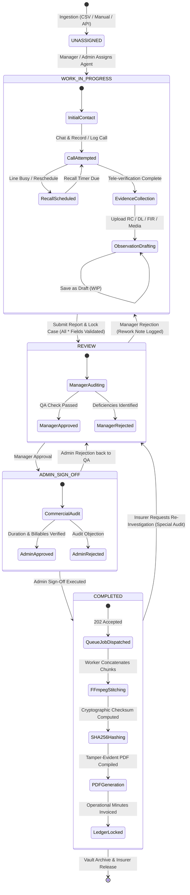

# 🔄 03. End-to-End State Machine and Operational Workflows

## 1. The Core Lifecycle State Machine

Every motor claim entering the platform moves through a deterministic, audit-trailed state machine. No transition can bypass validation rules.

---

## 2. State-by-State Lifecycle Specification

### State 1: `UNASSIGNED`
* **Trigger**: A new claim batch is imported via Bulk CSV/Excel, entered manually through the `+ Add Case` modal, or received via Insurer API.
* **Pre-conditions**:
  * Mandatory fields present: Case ID (Unique), Insurer ID, Insured Name, Vehicle Reg No, Policy No, Vehicle Class (`HEAVY_VEHICLE` or `LMV`), Claim Type (`OD`, `TP`, `IBNR`, `281`).
* **Permitted Actions**:
  * View case summary in Cases Vault.
  * Assign to an Agent (shows agent's active load: `Agent Name (X active)`).
* **Allowed Actors**: Manager, Admin.
* **Exit Transition**: When an agent is assigned, status becomes `WORK_IN_PROGRESS`. `assigned_agent_id` and `assigned_at` (UTC) are persisted.

---

### State 2: `WORK_IN_PROGRESS` (WIP)
* **Trigger**: Case assigned to an investigator.
* **Core Agent Activities**:
  1. **Tele-Verification**: Click **Chat & Record** next to contact (Insured, Driver, Owner, Garage Mechanic) to launch WhatsApp Web and activate the browser `MediaRecorder` (5-second streaming chunks).
  2. **Recall Management**: If the contact's line is busy, switched off, or asks for a callback, log a remark and set a **Recall Timer** (`15M`, `30M`, `1H`, `2H`, `4H`, `1D`, or `CUSTOM`).
  3. **Evidence Upload**: Upload supplemental documents (RC, DL, FIR/GD, Commercial Permit, Load Challan, Garage Estimates, live call screenshots).
  4. **Observation Capture**: Populate the 10 compulsory observation fields (`*`).
* **Save as Draft vs. Submit**:
  * **Save as Draft**: Persists partial notes, contacts, and observation inputs without validating mandatory fields. Case remains in `WORK_IN_PROGRESS`.
  * **Submit Report & Lock Case**: Validates all 10 mandatory fields, ensures at least one tele-verification recording or fallback statement exists, locks agent write permissions, and triggers transition to `REVIEW`.
* **Allowed Actors**: Assigned Agent (Read/Write), Manager & Admin (Read/Audit).

---

### State 3: `REVIEW` (Quality Audit Queue)
* **Trigger**: Agent submits locked dossier.
* **Core Manager Activities**:
  * Review all 10 observation fields against uploaded documents and recorded audio/video streams.
  * Verify that driver identity matches the license attached and that accident narrative is logically consistent.
  * Verify whether repudiation grounds (if selected) are substantiated by evidence.
* **Outcomes**:
  * **Approve**: Case moves to `ADMIN_SIGN_OFF`.
  * **Reject (Rework Loop)**: Manager provides compulsory rejection remarks (e.g., *"Cleaner statement missing", "Driving license image blurred, re-request from insured"*). Case moves back to `WORK_IN_PROGRESS`. Agent is notified and case is flagged with a `REWORK` pill.
* **Allowed Actors**: Manager, Admin.

---

### State 4: `ADMIN_SIGN_OFF` (Commercial & Executive Verification)
* **Trigger**: Manager approves QA review.
* **Core Admin Activities**:
  * Audit total recorded call duration (sum of all verified recording sessions).
  * Check billing rate category applicable for the insurer and vehicle class.
  * Provide final sign-off approval or return to `REVIEW` with objections.
* **Allowed Actors**: Admin (Owner).
* **Exit Transition**: Clicking **Approve & Sign Off** transitions case to `COMPLETED`.

---

### State 5: `COMPLETED` (Vault Lock & Client Release)
* **Trigger**: Admin signs off.
* **Automated Asynchronous Execution (202 Pattern)**:
  1. API locks case record (no further edits permitted).
  2. Background task enqueued to Redis (`hibiken/asynq`):
     * Video/Audio worker concatenates all 5-second media chunks via FFmpeg.
     * Computes SHA-256 checksum of final master recording file.
     * Compiles tamper-evident PDF dossier (embedding metadata, 10 observation fields, screenshots, SHA-256 hash, and QR code).
     * Calculates billable operational minutes (rounded or per exact contract terms) and writes to insurer billing ledger.
  3. Insurer portal gains immediate read/download access to final certified PDF and recording stream.
* **Allowed Actors**: Insurer (Read Only), Admin/Manager (Read Only).

---

## 3. The Reassignment & History Tracking Workflow

If an agent is on leave or overloaded, a Manager or Admin can reassign a case in `WORK_IN_PROGRESS`:
* The case receives a permanent `REASSIGNED` visual badge on the Cases Vault table.
* A record is inserted into the `case_assignments` audit log with:
  * `previous_agent_id`, `new_agent_id`, `assigned_by_user_id`, `reassignment_reason`, `timestamp` (UTC).
* Previous call logs, recordings, and drafted observations are preserved intact so the new agent can continue seamlessly.

---

## 4. Next Steps & Connected Knowledge

* For the visual layout of the Vault Grid and Dossier Modal, see [[04_Cases_Vault_and_Dossier_UI_Specification]].
* For the media streaming and WhatsApp recording engine, see [[06_Tele_Verification_and_Media_Recording_Pipeline]].
* For background job orchestration on transition to `COMPLETED`, see [[07_Background_Processing_and_Queue_Architecture]].
