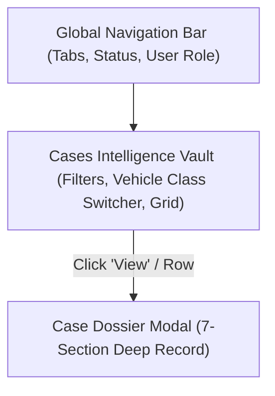
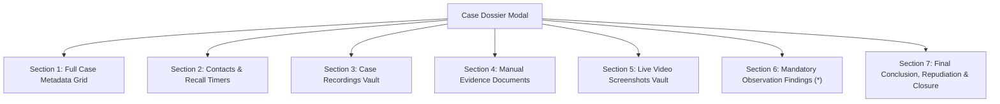

# 🖥️ 04. Cases Vault and Dossier UI Specification

## 1. Global Navigation & Layout Architecture

The user interface is designed for high-density, error-free operational throughput. The layout consists of a persistent global navigation bar and a multi-view application shell:



### Global Top Bar Elements
* **Navigation Tabs**:
  * `Dashboard`: High-level operational throughput, aging alerts, team metrics.
  * `Intelligence Archives`: Read-only historical claims and search index.
  * `Cases Vault`: Primary operational command center (data grid).
  * `Agent Hub`: Agent caseload balancing, availability status, active recalls.
  * `Commercial Metrics`: (**Admin Only**) Insurer rate cards, billable minute ledger, invoice generation.
* **Global Status Indicators**:
  * Connection Status Pill: `🟢 Connected` (via WebSocket/SSE heartbeat).
  * Active Role Badge: `👑 Admin (Owner)`, `👔 Manager (QA)`, or `🕵️ Agent`.
  * User Avatar & Organization Profile Switcher.

---

## 2. Cases Intelligence Vault (Main Data Grid)

The main Cases Vault enables investigators and managers to filter, sort, and triage claims instantaneously.

```
+-------------------------------------------------------------------------------------------------------+
| [Heavy Weight Commercial Vehicle] | (Light Weight Motor Vehicle)     [OD] [TP] [IBNR] [281] [Other]   |
+-------------------------------------------------------------------------------------------------------+
| Filters: [All (142)] [UNASSIGNED (18)] [WIP (64)] [REVIEW (32)] [COMPLETED (28)]  [Show Reassigned Only] |
| Search: [🔍 Search Case ID, Reg No, Insured, Phone...]   [Import CSV] [+ Add Case] [Export] [Template]|
+-------------------------------------------------------------------------------------------------------+
| Case Identity | Insured Party         | Dossier Contacts        | Category / Agent     | Status / Act |
|---------------+-----------------------+-------------------------+----------------------+--------------|
| MOT18221241   | Ramesh Kumar          | [INSURED: 9876543210]   | OD                   | [WORK IN     |
| MH-12-AB-1234 | Pol: POL-99210-A      | [OWNER:   9876543210]   | Palak Gupta          |  PROGRESS]   |
| [AGING: 2D]   | Loss: 12-Oct-2026     | [DRIVER:  9123456789]   | (12 active)          |              |
| [20M 24S]     | Trigger: Drunk & Drive|                         | [Reassign v]         | [✏️] [👁️ View]|
+-------------------------------------------------------------------------------------------------------+
```

### Key Grid Columns & Interactive Elements
1. **Case Identity**:
   * Unique Case ID (`MOT18221241`), State (`Maharashtra`), District (`Pune`).
   * **Aging Badge**: Visual indicator of intake latency (e.g., `AGING: 2D` in green; `AGING: >15D` in amber/red).
   * **Total Duration Badge**: Cumulative recorded tele-verification time (e.g., `20M 24S`).
   * **REASSIGNED Flag**: Amber pill displayed if the case was reallocated from a prior investigator.
2. **Insured Party & Policy Metadata**:
   * Insured Name, Primary Contact Phone, Policy Number, Vehicle Registration Number.
   * Accident/Loss Date, Intimation Date, and Insurer Suspicion Trigger snippet.
3. **Dossier Contacts Quick-Pills**:
   * Color-coded pills for `INSURED`, `OWNER OF VEHICLE`, and `DRIVER OF VEHICLE` with one-click copy and call launch.
4. **Category & Assignment Dropdowns**:
   * Inline toggle for claim type (`OD` - Own Damage / `TP` - Third Party).
   * Agent assignment dropdown displaying live workload: `Palak Gupta (12 active)`.
5. **Status & Action Buttons**:
   * Status badge reflecting state (`UNASSIGNED`, `WORK IN PROGRESS`, `REVIEW`, `COMPLETED`).
   * Quick Edit (pencil icon) for basic metadata.
   * **View Button**: Opens the full 7-Section Dossier Modal.

---

## 3. Complete Vault Record: The 7-Section Dossier Modal

The Dossier Modal is the comprehensive operational workbench where investigations are conducted, documented, and locked.



---

### Section 1: Full Case Details (Header & Metadata Grid)
* Displays read-only and inline-editable metadata:
  * **Identifiers**: Case ID, Policy Number, Vehicle Registration No, Accused Vehicle No (TP claims).
  * **Dates**: Import Date, Loss Date, Intimation Date, Assigned At timestamp.
  * **Commercials**: Insurer Organization (e.g., `@icicilombard.com`), Claim Estimated Amount (₹), Claim Type.
  * **Vehicle Info**: Make, Model, Manufacturing Year, Chassis No, Engine No, Vehicle Class (`Heavy Commercial` / `LMV`).

---

### Section 2: Dossier Contacts Directory & Callback Remarks
Structured as a two-column operational panel:
* **Left Column (Contacts Directory)**:
  * Lists verified contacts: Insured, Owner, Registered Driver, Garage Mechanic.
  * Action buttons per contact:
    * `Log Call`: Opens a note-taking modal without launching screen recorder (for offline phone calls).
    * `Chat & Record`: Automatically generates a WhatsApp Web deep link (`https://web.whatsapp.com/send?phone=...`) and activates the browser's audio/screen recorder engine.
  * Form to `+ Register Additional Contact` (Name, Relation, Phone, Address).
* **Right Column (Follow-Up Remarks & Callback Recall Timers)**:
  * Timeline of past call attempts with timestamps and agent notes.
  * Call disposition selector: `General Note`, `Line Busy`, `Ringing No Answer`, `Asked for Callback`, `Hostile/Refused`.
  * **Recall Timer Picker**: Quick buttons (`NONE`, `15M`, `30M`, `1H`, `2H`, `4H`, `1D`) plus custom date-time picker. Triggers browser notifications and highlights overdue cases in the Agent Hub.

---

### Section 3: Case Recordings Vault
* Lists all completed tele-verification sessions for the case.
* Displays per-recording metadata: Recording ID, Timestamp (IST), Duration (`MM:SS`), File Size, and SHA-256 Checksum badge.
* Inline audio/video player with playback speed controls (0.5x, 1x, 1.5x, 2x).
* **Upload Recording Button**: Fallback file uploader (`.mp4`, `.webm`, `.m4a`, `.mp3`) for offline recordings captured outside the browser recorder.

---

### Section 4: Manual Case Documents
* Drag-and-drop multi-file uploader supporting PDF, DOCX, XLSX, PNG, JPG, and ZIP files.
* Categorized document tagging:
  * `RC` (Registration Certificate)
  * `DL` (Driving License of Driver at time of accident)
  * `FIR / GD / Compromise Memo` (Police Station documents)
  * `Commercial Permit & Fitness` (Compulsory for Heavy Commercial Vehicles)
  * `Weighbridge Slip / Load Challan` (For overloading fraud checks)
  * `Garage Repair Estimate & Photos`
* One-click preview modal and deletion protection (once case is locked).

---

### Section 5: Screenshots & Media Vault
* Real-time gallery displaying timestamped screenshots captured by the agent during the live video call (via a quick snapshot shortcut key or button in the recorder toolbar).
* Displays live GPS coordinates (if WhatsApp location shared) and image metadata.
* `+ Upload Screenshot` button for manual image additions.

---

### Section 6: Trigger Narrative & Structured Observation Fields (`*` Mandatory)
* **Insurer Suspicion Trigger**: Read-only display of the insurer's initial trigger (e.g., *"Driver implant suspected; accident at 2 AM, intimation delayed by 14 days"*).
* **Mandatory Agent Trigger Remarks (`*`)**: Investigator's direct answer to the insurer's suspicion.
* **Structured Observation Form (10 Compulsory Fields)**:
  1. Insured Version (`*`)
  2. Driver Version (`*`)
  3. Pillion Rider / Occupant / Cleaner (Helper) Version (`*`)
  4. Relation with Insured / Driver / Occupant (`*`)
  5. KYC Documents of All Persons Contacted (`*`)
  6. Profession of All Persons Contacted (`*`)
  7. Hospital / Injury Remarks (`*`)
  8. Damages & Garage Remarks (`*`)
  9. Social Media / News Verification (`*`)
  10. Evidences Remarks (`*`)
* **Header Summary Badges**: Auto-summarizes key observation states (`OBS DL Status`, `OBS Call Details`, `OBS Gallery WhatsApp`, `OBS Google Timeline`, `OBS RC Remarks`, `OBS Policy Remarks`, `OBS FIR GD Compromise`).

---

### Section 7: Final Conclusion & Case Closure
* **Cascading Dropdowns**:
  * **Success Tagging (`*`)**: Select from `Genuine`, `Repudiated`, `Compromised`, `Claim Withdrawn by Insured`.
  * **Ground of Repudiation (`*`)**: Dynamically populated when `Repudiated` is selected:
    * *Driver Misrepresentation / Implant*
    * *Pre-Existing / Old Damages*
    * *Commercial Permit / Fitness Invalid*
    * *Gross Overloading / Illegal Passengers*
    * *Drunk and Driving / Breach of Policy Condition*
    * *Staged Incident / Fraudulent Collusion*
  * **Final Closure Status (`*`)**: Select closure disposition.
  * **Conclusion (`*`)**: High-level investigative finding.
  * **Final Detailed Remarks (`*`)**: Comprehensive narrative.
* **Execution Action Bar**:
  * `Save as Draft`: Persists all inputs to PostgreSQL JSONB without validating `*` fields. Keeps case in `WORK_IN_PROGRESS`.
  * `Submit Report & Lock Case`: Runs strict client-side and server-side validation on all mandatory `*` fields. On success, transitions case to `REVIEW` and locks form fields from further editing.

---

## 4. Next Steps & Connected Knowledge

* For the underlying PostgreSQL schema backing these UI sections, see [[05_Database_Schema_and_Entity_Relationships]].
* For the technical mechanics of the `Chat & Record` tele-verification engine, see [[06_Tele_Verification_and_Media_Recording_Pipeline]].
* For the dynamic JSONB validation engine powering Section 6, see [[08_Dossier_Observation_Engine_and_Dynamic_Templates]].
