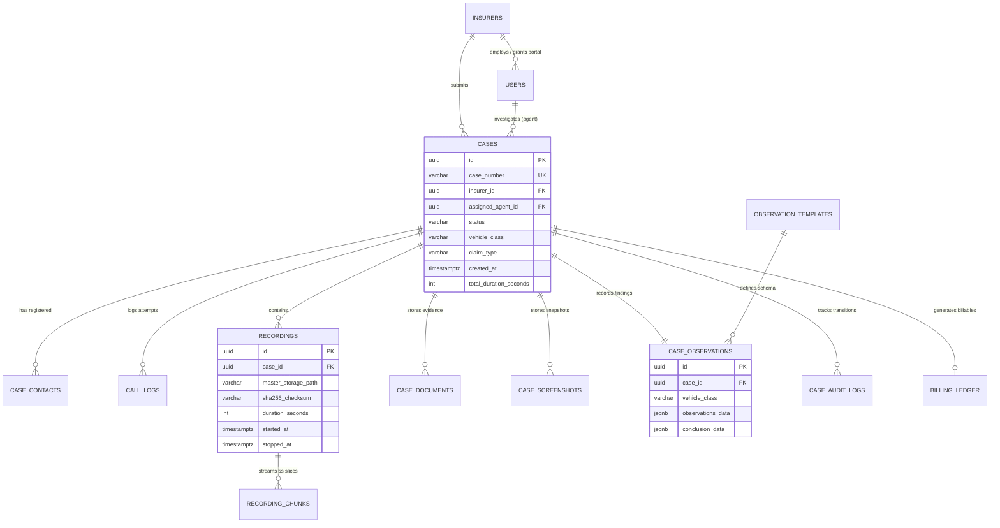

# 🗄️ 05. Database Schema and Entity Relationships

## 1. Entity-Relationship Overview

The platform uses **PostgreSQL 16** with strict foreign key constraints, `TIMESTAMPTZ` for timezone fidelity (UTC), integer-based duration counters, and `JSONB` for vehicle-specific dynamic observation templates.



---

## 2. Complete Production PostgreSQL DDL

```sql
-- Enable UUID extension
CREATE EXTENSION IF NOT EXISTS "uuid-ossp";

-- ============================================================================
-- 1. Insurers & User Tenancy
-- ============================================================================
CREATE TABLE insurers (
    id UUID PRIMARY KEY DEFAULT uuid_generate_v4(),
    name VARCHAR(255) NOT NULL,
    code VARCHAR(50) NOT NULL UNIQUE,
    contact_email VARCHAR(255) NOT NULL,
    per_minute_rate_inr NUMERIC(10, 2) NOT NULL DEFAULT 45.00,
    is_active BOOLEAN NOT NULL DEFAULT TRUE,
    created_at TIMESTAMPTZ NOT NULL DEFAULT CURRENT_TIMESTAMP,
    updated_at TIMESTAMPTZ NOT NULL DEFAULT CURRENT_TIMESTAMP
);

CREATE TYPE user_role AS ENUM ('ADMIN', 'MANAGER', 'AGENT', 'INSURER');

CREATE TABLE users (
    id UUID PRIMARY KEY DEFAULT uuid_generate_v4(),
    insurer_id UUID REFERENCES insurers(id) ON DELETE SET NULL,
    email VARCHAR(255) NOT NULL UNIQUE,
    password_hash VARCHAR(255) NOT NULL,
    full_name VARCHAR(255) NOT NULL,
    role user_role NOT NULL,
    team_id UUID,
    is_active BOOLEAN NOT NULL DEFAULT TRUE,
    created_at TIMESTAMPTZ NOT NULL DEFAULT CURRENT_TIMESTAMP,
    updated_at TIMESTAMPTZ NOT NULL DEFAULT CURRENT_TIMESTAMP
);

-- ============================================================================
-- 2. Cases Core Table
-- ============================================================================
CREATE TYPE case_status AS ENUM (
    'UNASSIGNED', 
    'WORK_IN_PROGRESS', 
    'REVIEW', 
    'ADMIN_SIGN_OFF', 
    'COMPLETED'
);

CREATE TYPE vehicle_category AS ENUM (
    'HEAVY_VEHICLE', 
    'LMV'
);

CREATE TYPE claim_category AS ENUM (
    'OD', 
    'TP', 
    'IBNR', 
    '281', 
    'OTHER'
);

CREATE TABLE cases (
    id UUID PRIMARY KEY DEFAULT uuid_generate_v4(),
    case_number VARCHAR(64) NOT NULL UNIQUE, -- e.g. MOT18221241
    insurer_id UUID NOT NULL REFERENCES insurers(id),
    assigned_agent_id UUID REFERENCES users(id),
    team_id UUID,
    status case_status NOT NULL DEFAULT 'UNASSIGNED',
    vehicle_class vehicle_category NOT NULL DEFAULT 'LMV',
    claim_type claim_category NOT NULL DEFAULT 'OD',
    
    -- Insured & Vehicle Identifiers
    policy_number VARCHAR(128) NOT NULL,
    policy_start_date DATE,
    vehicle_reg_number VARCHAR(64) NOT NULL,
    accused_vehicle_number VARCHAR(64),
    insured_name VARCHAR(255) NOT NULL,
    insured_primary_phone VARCHAR(32) NOT NULL,
    vehicle_make_model VARCHAR(255),
    claim_amount NUMERIC(12, 2) DEFAULT 0.00,
    
    -- Incident Info
    state VARCHAR(128) NOT NULL,
    district VARCHAR(128) NOT NULL,
    accident_date TIMESTAMPTZ,
    intimation_date TIMESTAMPTZ,
    cause_of_loss TEXT,
    insurer_trigger_narrative TEXT,
    
    -- Operational & Reassignment Flags
    is_reassigned BOOLEAN NOT NULL DEFAULT FALSE,
    assigned_at TIMESTAMPTZ,
    submitted_at TIMESTAMPTZ,
    completed_at TIMESTAMPTZ,
    total_duration_seconds INT NOT NULL DEFAULT 0, -- Raw cumulative seconds
    
    created_at TIMESTAMPTZ NOT NULL DEFAULT CURRENT_TIMESTAMP,
    updated_at TIMESTAMPTZ NOT NULL DEFAULT CURRENT_TIMESTAMP,
    deleted_at TIMESTAMPTZ
);

CREATE INDEX idx_cases_status ON cases(status);
CREATE INDEX idx_cases_agent ON cases(assigned_agent_id);
CREATE INDEX idx_cases_reg_num ON cases(vehicle_reg_number);
CREATE INDEX idx_cases_insurer ON cases(insurer_id);

-- ============================================================================
-- 3. Case Contacts & Call Log History
-- ============================================================================
CREATE TYPE contact_role AS ENUM (
    'INSURED', 
    'OWNER_OF_VEHICLE', 
    'DRIVER_OF_VEHICLE', 
    'GARAGE_MECHANIC', 
    'WITNESS', 
    'OTHER'
);

CREATE TABLE case_contacts (
    id UUID PRIMARY KEY DEFAULT uuid_generate_v4(),
    case_id UUID NOT NULL REFERENCES cases(id) ON DELETE CASCADE,
    role contact_role NOT NULL,
    full_name VARCHAR(255) NOT NULL,
    phone VARCHAR(32) NOT NULL,
    address TEXT,
    is_primary BOOLEAN NOT NULL DEFAULT FALSE,
    created_at TIMESTAMPTZ NOT NULL DEFAULT CURRENT_TIMESTAMP
);

CREATE TYPE call_disposition AS ENUM (
    'GENERAL_NOTE', 
    'LINE_BUSY', 
    'RINGING_NO_ANSWER', 
    'ASKED_FOR_CALLBACK', 
    'HOSTILE_REFUSED', 
    'CALL_COMPLETED'
);

CREATE TABLE call_logs (
    id UUID PRIMARY KEY DEFAULT uuid_generate_v4(),
    case_id UUID NOT NULL REFERENCES cases(id) ON DELETE CASCADE,
    contact_id UUID REFERENCES case_contacts(id) ON DELETE SET NULL,
    agent_id UUID NOT NULL REFERENCES users(id),
    disposition call_disposition NOT NULL,
    notes TEXT,
    recall_at TIMESTAMPTZ, -- UTC timestamp for follow-up timer
    created_at TIMESTAMPTZ NOT NULL DEFAULT CURRENT_TIMESTAMP
);

CREATE INDEX idx_call_logs_recall ON call_logs(agent_id, recall_at) WHERE recall_at IS NOT NULL;

-- ============================================================================
-- 4. In-Browser Media Recordings & 5-Second Chunks
-- ============================================================================
CREATE TYPE recording_status AS ENUM ('STREAMING', 'PROCESSING', 'READY', 'FAILED');

CREATE TABLE recordings (
    id UUID PRIMARY KEY DEFAULT uuid_generate_v4(),
    case_id UUID NOT NULL REFERENCES cases(id) ON DELETE CASCADE,
    agent_id UUID NOT NULL REFERENCES users(id),
    contact_id UUID REFERENCES case_contacts(id),
    status recording_status NOT NULL DEFAULT 'STREAMING',
    duration_seconds INT NOT NULL DEFAULT 0,
    master_storage_path VARCHAR(512), -- Storage key in MinIO/S3, NOT /uploads/!
    sha256_checksum VARCHAR(64),     -- Calculated post-concatenation
    file_size_bytes BIGINT NOT NULL DEFAULT 0,
    mime_type VARCHAR(64) NOT NULL DEFAULT 'video/webm',
    started_at TIMESTAMPTZ NOT NULL,
    stopped_at TIMESTAMPTZ,
    created_at TIMESTAMPTZ NOT NULL DEFAULT CURRENT_TIMESTAMP
);

-- Stores sequential 5-second slices uploaded from the browser
CREATE TABLE recording_chunks (
    id UUID PRIMARY KEY DEFAULT uuid_generate_v4(),
    recording_id UUID NOT NULL REFERENCES recordings(id) ON DELETE CASCADE,
    chunk_index INT NOT NULL, -- 0, 1, 2, ...
    storage_path VARCHAR(512) NOT NULL,
    duration_seconds NUMERIC(6, 2) NOT NULL DEFAULT 5.00,
    size_bytes INT NOT NULL,
    created_at TIMESTAMPTZ NOT NULL DEFAULT CURRENT_TIMESTAMP,
    UNIQUE (recording_id, chunk_index)
);

-- ============================================================================
-- 5. Supplemental Documents & Live Video Screenshots
-- ============================================================================
CREATE TYPE document_category AS ENUM (
    'RC', 
    'DL', 
    'FIR_GD_COMPROMISE', 
    'COMMERCIAL_PERMIT', 
    'FITNESS_CERTIFICATE', 
    'LOAD_CHALLAN_WEIGHBRIDGE', 
    'GARAGE_ESTIMATE', 
    'OTHER_EVIDENCE'
);

CREATE TABLE case_documents (
    id UUID PRIMARY KEY DEFAULT uuid_generate_v4(),
    case_id UUID NOT NULL REFERENCES cases(id) ON DELETE CASCADE,
    uploaded_by_id UUID NOT NULL REFERENCES users(id),
    doc_category document_category NOT NULL,
    file_name VARCHAR(255) NOT NULL,
    storage_path VARCHAR(512) NOT NULL,
    file_size_bytes BIGINT NOT NULL,
    mime_type VARCHAR(128) NOT NULL,
    created_at TIMESTAMPTZ NOT NULL DEFAULT CURRENT_TIMESTAMP
);

CREATE TABLE case_screenshots (
    id UUID PRIMARY KEY DEFAULT uuid_generate_v4(),
    case_id UUID NOT NULL REFERENCES cases(id) ON DELETE CASCADE,
    recording_id UUID REFERENCES recordings(id) ON DELETE SET NULL,
    uploaded_by_id UUID NOT NULL REFERENCES users(id),
    storage_path VARCHAR(512) NOT NULL,
    timestamp_offset_seconds INT NOT NULL DEFAULT 0,
    caption TEXT,
    created_at TIMESTAMPTZ NOT NULL DEFAULT CURRENT_TIMESTAMP
);

-- ============================================================================
-- 6. Dynamic JSONB Observation Engine & Templates
-- ============================================================================
CREATE TABLE observation_templates (
    id UUID PRIMARY KEY DEFAULT uuid_generate_v4(),
    vehicle_class vehicle_category NOT NULL,
    version INT NOT NULL DEFAULT 1,
    fields_schema JSONB NOT NULL, -- JSON Schema defining validation rules
    is_active BOOLEAN NOT NULL DEFAULT TRUE,
    created_at TIMESTAMPTZ NOT NULL DEFAULT CURRENT_TIMESTAMP,
    UNIQUE (vehicle_class, version)
);

CREATE TABLE case_observations (
    id UUID PRIMARY KEY DEFAULT uuid_generate_v4(),
    case_id UUID NOT NULL REFERENCES cases(id) ON DELETE CASCADE UNIQUE,
    vehicle_class vehicle_category NOT NULL,
    template_version INT NOT NULL DEFAULT 1,
    
    -- Dynamic JSONB containing the 10 compulsory fields + vehicle-specific answers
    observations_data JSONB NOT NULL DEFAULT '{}'::jsonb,
    
    -- Dynamic JSONB containing conclusion, repudiation ground, remarks
    conclusion_data JSONB NOT NULL DEFAULT '{}'::jsonb,
    
    submitted_at TIMESTAMPTZ,
    updated_at TIMESTAMPTZ NOT NULL DEFAULT CURRENT_TIMESTAMP
);

CREATE INDEX idx_observations_gin ON case_observations USING gin(observations_data);

-- ============================================================================
-- 7. Audit Trail & Commercial Billing Ledger
-- ============================================================================
CREATE TABLE case_audit_logs (
    id UUID PRIMARY KEY DEFAULT uuid_generate_v4(),
    case_id UUID NOT NULL REFERENCES cases(id) ON DELETE CASCADE,
    actor_id UUID NOT NULL REFERENCES users(id),
    action VARCHAR(64) NOT NULL, -- STATUS_CHANGE, REASSIGNMENT, FIELD_OVERRIDE
    previous_state JSONB,
    new_state JSONB,
    remarks TEXT,
    created_at TIMESTAMPTZ NOT NULL DEFAULT CURRENT_TIMESTAMP
);

CREATE TABLE billing_ledger (
    id UUID PRIMARY KEY DEFAULT uuid_generate_v4(),
    case_id UUID NOT NULL REFERENCES cases(id) UNIQUE,
    insurer_id UUID NOT NULL REFERENCES insurers(id),
    recording_duration_seconds INT NOT NULL, -- Raw seconds from recordings
    billable_minutes INT NOT NULL,           -- CEIL(duration / 60)
    rate_per_minute_inr NUMERIC(10, 2) NOT NULL,
    total_billed_inr NUMERIC(10, 2) NOT NULL,
    invoice_reference VARCHAR(64),
    is_paid BOOLEAN NOT NULL DEFAULT FALSE,
    created_at TIMESTAMPTZ NOT NULL DEFAULT CURRENT_TIMESTAMP
);
```

---

## 3. Critical Architecture Alignments in Schema

1. **Storage Paths (`storage_path`, `master_storage_path`)**: Notice these columns store relative object keys (e.g., `cases/MOT18221241/chunks/chunk_0.webm`), **never** absolute server paths like `/var/uploads/chunk_0.webm`. See [[11_The_6_Architectural_Pillars_and_Trap_Mitigations|Rule 1]].
2. **Raw Duration Storage (`duration_seconds`, `recording_duration_seconds`)**: Saved as pure non-negative integers. No floating point rounding bugs or time string conversions occur inside the database.
3. **UTC Timestamps (`TIMESTAMPTZ`)**: All event times are recorded in coordinated universal time. Presentation in IST (`UTC+05:30`) occurs purely at the UI/PDF boundary. See [[11_The_6_Architectural_Pillars_and_Trap_Mitigations|Rule 6]].

---

## 4. Next Steps & Connected Knowledge

* To see how the browser streams into `recording_chunks`, read [[06_Tele_Verification_and_Media_Recording_Pipeline]].
* To see how background workers query `recording_chunks` to assemble master files, read [[07_Background_Processing_and_Queue_Architecture]].
* To explore the JSON structure stored in `case_observations`, read [[08_Dossier_Observation_Engine_and_Dynamic_Templates]].
