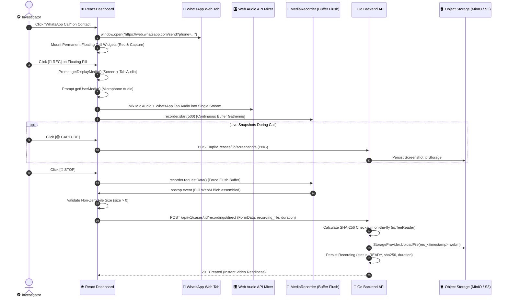
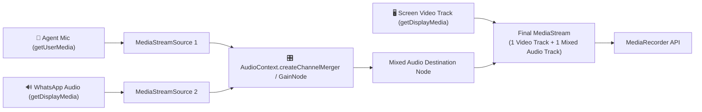

# 🎙️ 06. Tele-Verification and Media Recording Pipeline

## 1. Pipeline Overview & WhatsApp Web Interaction

The tele-verification engine allows an insurance investigator to conduct video/voice calls over **WhatsApp Web** while capturing screen and bi-directional audio directly inside the browser—without requiring any third-party desktop surveillance or recording software.



---

## 2. Audio Track Mixing (The Dual-Stream Audio Challenge)

A common point of failure in browser recording is capturing only the agent's microphone or only the remote speaker's audio. To ensure legal admissibility, **both** parties must be audible on the final recording:



### TypeScript Implementation of Audio Mixer

```typescript
// hooks/useTeleVerificationRecorder.ts
export async function startVerificationCapture() {
  // 1. Capture screen with tab audio (WhatsApp Web)
  const displayStream = await navigator.mediaDevices.getDisplayMedia({
    video: { displaySurface: "browser" },
    audio: true // Captures audio from the selected WhatsApp tab
  });

  // 2. Capture agent's microphone
  const micStream = await navigator.mediaDevices.getUserMedia({
    audio: { echoCancellation: true, noiseSuppression: true }
  });

  // 3. Mix both audio streams using Web Audio API
  const audioCtx = new AudioContext();
  const mixedAudioDestination = audioCtx.createMediaStreamDestination();

  // Route screen/tab audio to mixer
  if (displayStream.getAudioTracks().length > 0) {
    const displaySource = audioCtx.createMediaStreamSource(displayStream);
    displaySource.connect(mixedAudioDestination);
  }

  // Route microphone audio to mixer
  if (micStream.getAudioTracks().length > 0) {
    const micSource = audioCtx.createMediaStreamSource(micStream);
    micSource.connect(mixedAudioDestination);
  }

  // 4. Combine display video track with mixed audio track
  const tracks = [
    ...displayStream.getVideoTracks(),
    ...mixedAudioDestination.stream.getAudioTracks()
  ];

  return new MediaStream(tracks);
}
```

---

## 3. Direct Recording Architecture with Forced Buffer Flush (Evolution from 5s Chunking)

> [!NOTE]
> **Architectural Evolution & Scale Rationale**:
> Earlier prototypes evaluated slicing media into 5-second chunks (`recorder.start(5000)`) and streaming them continuously to Redis/Asynq for chunk recovery and background FFmpeg stitching.
> 
> **Why that idea was dropped**:
> 1. **Realistic Platform Scale**: The platform is built for ~100 simultaneous field investigators, not millions of live consumer streams.
> 2. **Network Fragility of 5s Slicing**: Slicing every 5 seconds across 100 concurrent agents meant 20 HTTP multipart uploads hitting the server every single second. Transient cellular drops caused missing chunks, out-of-order writes, and frequent FFmpeg stitch failures.
> 3. **The Clean Production Architecture**: Slices are buffered in memory (`recorder.start(500)`). On stop, `mediaRecorder.requestData()` is invoked to force-flush codec buffers before resolving `onstop`. The assembled WebM blob is uploaded directly via `POST /api/v1/cases/:id/recordings/direct`. This provides 100% video integrity, eliminates zero-byte corruptions, and calculates SHA-256 on the fly without complex Redis chunk queues.

### Frontend Implementation (`PermanentCallWidgets.tsx`)

```typescript
// Permanent moveable recording widget with guaranteed buffer flush
export function useDirectRecordingEngine(caseId: string) {
  const mediaRecorderRef = useRef<MediaRecorder | null>(null);
  const recordedChunksRef = useRef<Blob[]>([]);
  const [isRecording, setIsRecording] = useState(false);
  const [isPaused, setIsPaused] = useState(false);
  const [elapsedSeconds, setElapsedSeconds] = useState(0);

  // START RECORDING
  const startRecording = (stream: MediaStream) => {
    recordedChunksRef.current = [];
    const recorder = new MediaRecorder(stream, {
      mimeType: "video/webm;codecs=vp8,opus",
      videoBitsPerSecond: 1_200_000
    });

    recorder.ondataavailable = (e) => {
      if (e.data && e.data.size > 0) {
        recordedChunksRef.current.push(e.data);
      }
    };

    mediaRecorderRef.current = recorder;
    // Collect slices continuously in memory
    recorder.start(500);
    setIsRecording(true);
    setIsPaused(false);
  };

  // PAUSE / RESUME
  const togglePause = () => {
    const recorder = mediaRecorderRef.current;
    if (!recorder) return;
    if (recorder.state === "recording") {
      recorder.pause();
      setIsPaused(true);
    } else if (recorder.state === "paused") {
      recorder.resume();
      setIsPaused(false);
    }
  };

  // STOP RECORDING & GUARANTEED FLUSH
  const stopRecordingAndUpload = async (): Promise<void> => {
    const recorder = mediaRecorderRef.current;
    if (!recorder || recorder.state === "inactive") return;

    // 1. Force flush pending hardware codec buffers
    if (recorder.state === "recording" || recorder.state === "paused") {
      try {
        recorder.requestData();
      } catch (err) {
        console.warn("requestData error:", err);
      }
    }

    // 2. Wait for stop completion
    await new Promise<void>((resolve) => {
      recorder.onstop = () => resolve();
      recorder.stop();
    });

    // 3. Assemble full consolidated video Blob
    const fullBlob = new Blob(recordedChunksRef.current, { type: "video/webm" });
    if (fullBlob.size === 0) {
      throw new Error("Recording captured 0 bytes");
    }

    // 4. Direct upload with duration
    const formData = new FormData();
    formData.append("recording_file", fullBlob, `rec_${Date.now()}.webm`);
    formData.append("duration_seconds", Math.max(1, elapsedSeconds).toString());

    await fetch(`/api/v1/cases/${caseId}/recordings/direct`, {
      method: "POST",
      body: formData,
      headers: {
        Authorization: `Bearer ${getAuthToken()}`
      }
    });

    setIsRecording(false);
  };

  return { startRecording, togglePause, stopRecordingAndUpload, isRecording, isPaused, elapsedSeconds };
}
```

---

## 4. Live Call Video Screenshot Capture

While on the WhatsApp video call with the driver or insured, the agent can click **Capture Snapshot** on the floating pill widget (or press hotkey) to capture evidentiary frames (odometer, chassis plate, driver face, damage):

```typescript
export async function captureLiveSnapshot(
  videoTrack: MediaStreamTrack,
  caseId: string,
  offsetSeconds: number,
  caption?: string
) {
  // Dual-pipeline: ImageCapture API with DOM Video fallback
  let blob: Blob | null = null;
  
  if ("ImageCapture" in window) {
    try {
      const imageCapture = new (window as any).ImageCapture(videoTrack);
      const bitmap = await imageCapture.grabFrame();
      const canvas = document.createElement("canvas");
      canvas.width = bitmap.width;
      canvas.height = bitmap.height;
      const ctx = canvas.getContext("2d");
      ctx?.drawImage(bitmap, 0, 0);
      blob = await new Promise<Blob | null>((res) => canvas.toBlob(res, "image/png"));
    } catch {
      // Fallback to video element
    }
  }

  if (!blob) {
    const video = document.createElement("video");
    video.srcObject = new MediaStream([videoTrack]);
    await video.play();
    const canvas = document.createElement("canvas");
    canvas.width = video.videoWidth || 1280;
    canvas.height = video.videoHeight || 720;
    const ctx = canvas.getContext("2d");
    ctx?.drawImage(video, 0, 0, canvas.width, canvas.height);
    blob = await new Promise<Blob | null>((res) => canvas.toBlob(res, "image/png"));
  }

  if (!blob) throw new Error("Frame capture failed");

  const formData = new FormData();
  formData.append("screenshot", blob, `shot_${Date.now()}.png`);
  formData.append("timestamp_offset_seconds", offsetSeconds.toString());
  if (caption) formData.append("caption", caption);

  await fetch(`/api/v1/cases/${caseId}/screenshots`, {
    method: "POST",
    body: formData,
    headers: { Authorization: `Bearer ${getAuthToken()}` }
  });
}
```

---

## 5. Backend Direct Recording Receiver Handler (Go)

The Go backend saves the finalized video directly to the configured `StorageProvider` (MinIO/S3 or Local), calculates the cryptographic SHA-256 hash on-the-fly using `io.TeeReader`, persists the record with status `READY`, and increments case duration:

```go
func (h *RecordingHandler) UploadDirectRecording(c *gin.Context) {
    caseID := c.Param("id")
    claims, _ := auth.GetUserClaims(c)

    fileHeader, err := c.FormFile("recording_file")
    if err != nil {
        c.JSON(http.StatusBadRequest, gin.H{"error": "missing recording_file"})
        return
    }
    if fileHeader.Size == 0 {
        c.JSON(http.StatusBadRequest, gin.H{"error": "uploaded recording file is empty (0 bytes). Ensure recording captured video."})
        return
    }

    durationSec, _ := strconv.Atoi(c.PostForm("duration_seconds"))
    if durationSec < 1 {
        durationSec = 1
    }

    fileReader, err := fileHeader.Open()
    if err != nil {
        c.JSON(http.StatusInternalServerError, gin.H{"error": "cannot read file"})
        return
    }
    defer fileReader.Close()

    // Compute SHA-256 checksum on-the-fly while streaming into memory buffer
    hasher := sha256.New()
    buf := new(bytes.Buffer)
    tee := io.TeeReader(fileReader, hasher)
    if _, err := io.Copy(buf, tee); err != nil {
        c.JSON(http.StatusInternalServerError, gin.H{"error": "failed to buffer recording: " + err.Error()})
        return
    }
    checksum := hex.EncodeToString(hasher.Sum(nil))

    now := time.Now().UTC()
    storagePath := fmt.Sprintf("cases/%s/recordings/rec_%d.webm", caseID, now.Unix())
    fileSize := int64(buf.Len())

    _, err = h.storageProvider.UploadFile(c.Request.Context(), buf, storagePath, fileSize, "video/webm")
    if err != nil {
        c.JSON(http.StatusInternalServerError, gin.H{"error": "storage upload failed: " + err.Error()})
        return
    }

    rec := models.Recording{
        CaseID:            caseID,
        AgentID:           claims.UserID,
        Status:            models.RecordingReady,
        DurationSeconds:   durationSec,
        MasterStoragePath: &storagePath,
        FileSizeBytes:     fileSize,
        MimeType:          "video/webm",
        SHA256Checksum:    &checksum,
        StartedAt:         now.Add(-time.Duration(durationSec) * time.Second),
        StoppedAt:         &now,
    }
    h.db.Create(&rec)

    // Increment cumulative duration in case record
    h.db.Model(&models.Case{}).Where("id = ?", caseID).
        Update("total_duration_seconds", gorm.Expr("total_duration_seconds + ?", durationSec))

    // Log to Case Audit Trail
    h.db.Create(&models.CaseAuditLog{
        CaseID:  caseID,
        ActorID: claims.UserID,
        Action:  "RECORDING_UPLOADED",
        Remarks: fmt.Sprintf("Direct recording uploaded: %d seconds, SHA-256: %s", durationSec, checksum[:16]),
    })

    c.JSON(http.StatusCreated, rec)
}
```

> [!NOTE]
> **Legacy / Fallback Handlers**: The API also retains `UploadChunk` (`POST /cases/:id/recordings/:recId/chunks`) and `UploadFallbackRecording` (`POST /cases/:id/recordings/upload`) for compatibility with external MP4/M4A evidence uploads.

---

## 6. Next Steps & Connected Knowledge

* To see how background processing and PDF dossier generation operate, read [[07_Background_Processing_and_Queue_Architecture]].
* To review the architectural storage interface rules, see [[11_The_6_Architectural_Pillars_and_Trap_Mitigations]].
* For failure recovery during calls (accidental closure, audio permissions, offline fallback), see [[13_Edge_Cases_and_Failure_Recovery]].
