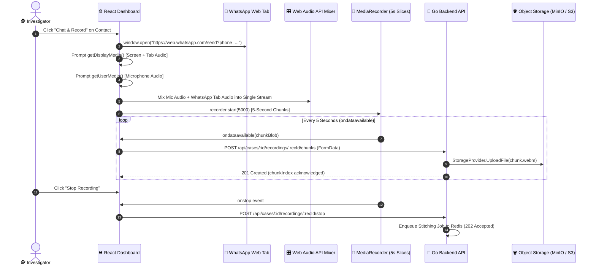
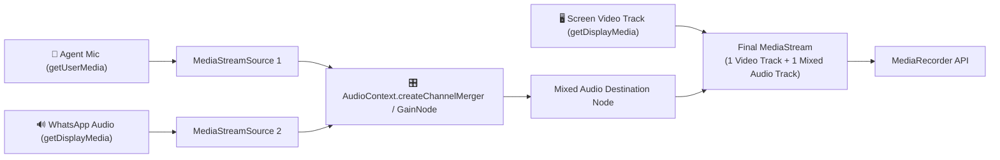

# 🎙️ 06. Tele-Verification and Media Recording Pipeline

## 1. Pipeline Overview & WhatsApp Web Interaction

The tele-verification engine allows an insurance investigator to conduct video/voice calls over **WhatsApp Web** while capturing screen and bi-directional audio directly inside the browser—without requiring any third-party desktop surveillance or recording software.



---

## 2. Audio Track Mixing (The Dual-Stream Audio Challenge)

A common point of failure in browser recording is capturing only the agent's microphone or only the remote speaker's audio. To ensure legal admissibility, **both** parties must be audible on the final recording:



### TypeScript Implementation of Audio Mixer

```typescript
// hooks/useTeleVerificationRecorder.ts
export async function startVerificationCapture() {
  // 1. Capture screen with tab audio (WhatsApp Web)
  const displayStream = await navigator.mediaDevices.getDisplayMedia({
    video: { displaySurface: "browser" },
    audio: true // Captures audio from the selected WhatsApp tab
  });

  // 2. Capture agent's microphone
  const micStream = await navigator.mediaDevices.getUserMedia({
    audio: { echoCancellation: true, noiseSuppression: true }
  });

  // 3. Mix both audio streams using Web Audio API
  const audioCtx = new AudioContext();
  const mixedAudioDestination = audioCtx.createMediaStreamDestination();

  // Route screen/tab audio to mixer
  if (displayStream.getAudioTracks().length > 0) {
    const displaySource = audioCtx.createMediaStreamSource(displayStream);
    displaySource.connect(mixedAudioDestination);
  }

  // Route microphone audio to mixer
  if (micStream.getAudioTracks().length > 0) {
    const micSource = audioCtx.createMediaStreamSource(micStream);
    micSource.connect(mixedAudioDestination);
  }

  // 4. Combine display video track with mixed audio track
  const tracks = [
    ...displayStream.getVideoTracks(),
    ...mixedAudioDestination.stream.getAudioTracks()
  ];

  return new MediaStream(tracks);
}
```

---

## 3. The 5-Second Chunking Architecture (Trap #2 Mitigation)

> [!CAUTION]
> **The Browser Media Recording Chunks Trap**: Waiting for a 2-hour call to finish and executing `recorder.onstop = () => uploadBlob(giant500MBBlob)` will crash the browser tab on low-spec laptops, exhaust browser memory, and lose all evidence if Wi-Fi disconnects.

### Frontend Chunk Streaming Engine

```typescript
export function initializeChunkStreaming(
  stream: MediaStream, 
  caseId: string, 
  recordingId: string
) {
  let chunkIndex = 0;
  const chunkQueue: { index: number; blob: Blob }[] = [];
  let isUploading = false;

  const recorder = new MediaRecorder(stream, {
    mimeType: "video/webm;codecs=vp8,opus",
    videoBitsPerSecond: 1_200_000 // 1.2 Mbps optimized for document clarity
  });

  // CRITICAL: Slice every 5000 ms
  recorder.ondataavailable = async (event: BlobEvent) => {
    if (event.data && event.data.size > 0) {
      chunkQueue.push({ index: chunkIndex++, blob: event.data });
      processQueue();
    }
  };

  async function processQueue() {
    if (isUploading || chunkQueue.length === 0) return;
    isUploading = true;

    const currentChunk = chunkQueue.shift()!;
    const formData = new FormData();
    formData.append("chunk_index", currentChunk.index.toString());
    formData.append("chunk_file", currentChunk.blob, `chunk_${currentChunk.index}.webm`);

    try {
      await fetch(`/api/cases/${caseId}/recordings/${recordingId}/chunks`, {
        method: "POST",
        body: formData
      });
    } catch (err) {
      // Re-queue chunk with retry backoff to prevent data loss
      console.error(`Chunk ${currentChunk.index} upload failed, retrying...`, err);
      chunkQueue.unshift(currentChunk);
    } finally {
      isUploading = false;
      if (chunkQueue.length > 0) processQueue();
    }
  }

  recorder.start(5000); // 5000 ms chunks
  return recorder;
}
```

---

## 4. Live Call Video Screenshot Capture

While on the WhatsApp video call with the driver or insured, the agent can click **Take Snapshot** or press a hotkey (`Spacebar` / `F8`) to capture evidence (e.g., driver's face, vehicle odometer, damaged bumper):

```typescript
export async function captureLiveSnapshot(
  videoElement: HTMLVideoElement,
  caseId: string,
  recordingId: string,
  offsetSeconds: number
) {
  const canvas = document.createElement("canvas");
  canvas.width = videoElement.videoWidth;
  canvas.height = videoElement.videoHeight;
  
  const ctx = canvas.getContext("2d");
  ctx?.drawImage(videoElement, 0, 0, canvas.width, canvas.height);

  canvas.toBlob(async (blob) => {
    if (!blob) return;
    const formData = new FormData();
    formData.append("screenshot", blob, `snapshot_${Date.now()}.png`);
    formData.append("recording_id", recordingId);
    formData.append("timestamp_offset_seconds", offsetSeconds.toString());

    await fetch(`/api/cases/${caseId}/screenshots`, {
      method: "POST",
      body: formData
    });
  }, "image/png");
}
```

---

## 5. Backend Chunk Receiver Handler (Go)

The Go backend saves incoming chunks directly to the configured `StorageProvider` (MinIO/S3), writes metadata into PostgreSQL, and responds with `201 Created` in under 30ms:

```go
func (h *RecordingHandler) UploadChunk(c *gin.Context) {
    caseID := c.Param("case_id")
    recordingID := c.Param("recording_id")
    chunkIndexStr := c.PostForm("chunk_index")
    chunkIndex, _ := strconv.Atoi(chunkIndexStr)

    fileHeader, err := c.FormFile("chunk_file")
    if err != nil {
        c.JSON(http.StatusBadRequest, gin.H{"error": "missing chunk file"})
        return
    }

    fileReader, err := fileHeader.Open()
    if err != nil {
        c.JSON(http.StatusInternalServerError, gin.H{"error": "cannot read file"})
        return
    }
    defer fileReader.Close()

    // Abstract storage key: NEVER hardcoded /uploads path!
    storagePath := fmt.Sprintf("cases/%s/recordings/%s/chunks/chunk_%06d.webm", caseID, recordingID, chunkIndex)

    _, err = h.storageProvider.UploadFile(c.Request.Context(), fileReader, storagePath)
    if err != nil {
        c.JSON(http.StatusInternalServerError, gin.H{"error": "failed to persist chunk"})
        return
    }

    // Persist to recording_chunks table
    err = h.db.Exec(`
        INSERT INTO recording_chunks (recording_id, chunk_index, storage_path, size_bytes)
        VALUES (?, ?, ?, ?)`,
        recordingID, chunkIndex, storagePath, fileHeader.Size,
    ).Error

    if err != nil {
        c.JSON(http.StatusInternalServerError, gin.H{"error": "failed to log chunk"})
        return
    }

    c.JSON(http.StatusCreated, gin.H{"status": "chunk_persisted", "index": chunkIndex})
}
```

---

## 6. Next Steps & Connected Knowledge

* To see how these uploaded chunks are assembled and stitched via FFmpeg, read [[07_Background_Processing_and_Queue_Architecture]].
* To review the architectural storage interface rules, see [[11_The_6_Architectural_Pillars_and_Trap_Mitigations]].
* For failure recovery during calls (Wi-Fi disconnects, tab reloads), see [[13_Edge_Cases_and_Failure_Recovery]].
