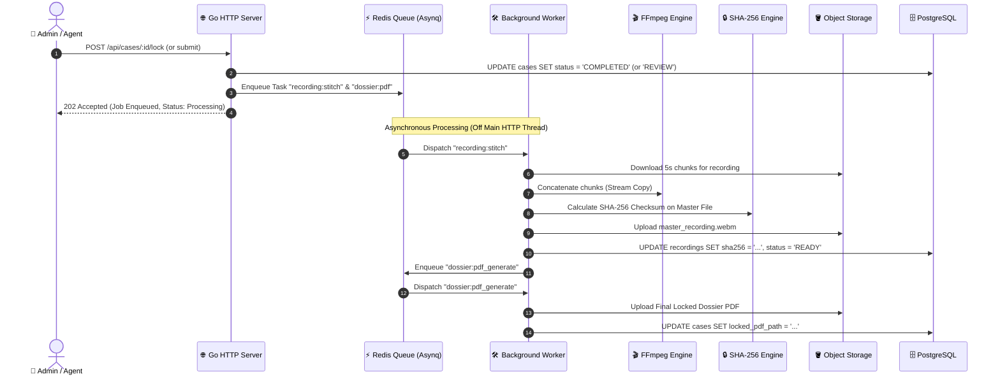

# ⚙️ 07. Background Processing and Queue Architecture

## 1. Background Job Isolation (Trap #3 Mitigation)

> [!CAUTION]
> **The Background Job Isolation Trap**: Running video stitching (`ffmpeg`), SHA-256 checksum calculation, and PDF rendering directly inside the HTTP request handler (`POST /api/cases/:id/submit`) will freeze the web server event loop, cause HTTP timeouts, and render the dashboard unresponsive for all users.

To maintain 100% responsiveness, all heavy computation is completely decoupled using an asynchronous worker queue backed by **Redis** and **`hibiken/asynq`** in Go:



---

## 2. Asynq Task Definitions & Enqueueing Pattern

### Enqueueing via HTTP Handler (Returns 202 Accepted Immediately)

```go
package handlers

import (
    "encoding/json"
    "net/http"
    "github.com/gin-gonic/gin"
    "github.com/hibiken/asynq"
)

type StitchTaskPayload struct {
    CaseID      string `json:"case_id"`
    RecordingID string `json:"recording_id"`
}

func (h *CaseHandler) SubmitCaseReport(c *gin.Context) {
    caseID := c.Param("id")
    
    // 1. Quick DB status update
    // ... validation logic ...
    
    // 2. Prepare payload for background queue
    payload, _ := json.Marshal(StitchTaskPayload{
        CaseID: caseID,
    })

    task := asynq.NewTask("recording:stitch", payload, asynq.MaxRetry(3))
    
    // 3. Enqueue to Redis
    _, err := h.asynqClient.Enqueue(task)
    if err != nil {
        c.JSON(http.StatusInternalServerError, gin.H{"error": "failed to enqueue task"})
        return
    }

    // 4. Return 202 Accepted immediately!
    c.JSON(http.StatusAccepted, gin.H{
        "status":  "ACCEPTED",
        "message": "Case submitted; background compilation enqueued",
        "case_id": caseID,
    })
}
```

---

## 3. Worker Implementation: FFmpeg Concatenation & SHA-256 Hashing

The worker downloads chunks to an isolated ephemeral scratch directory, invokes FFmpeg using stream copy (`-c copy`) for near-instantaneous execution without re-encoding, calculates the cryptographic hash, and uploads the master file to object storage.

```go
package tasks

import (
    "context"
    "crypto/sha256"
    "encoding/hex"
    "fmt"
    "io"
    "os"
    "os/exec"
    "path/filepath"
    "github.com/hibiken/asynq"
)

type StitchWorker struct {
    storage StorageProvider
    db      *gorm.DB
}

func (w *StitchWorker) HandleStitchTask(ctx context.Context, t *asynq.Task) error {
    var payload StitchTaskPayload
    json.Unmarshal(t.Payload(), &payload)

    // 1. Create temporary working directory
    scratchDir, err := os.MkdirTemp("", "stitch-"+payload.RecordingID)
    if err != nil {
        return err
    }
    defer os.RemoveAll(scratchDir) // Always clean up scratch files!

    // 2. Fetch list of chunks from database ordered by chunk_index
    var chunks []RecordingChunk
    w.db.Where("recording_id = ?", payload.RecordingID).
         Order("chunk_index ASC").Find(&chunks)

    // 3. Download all chunks and construct concat.txt for FFmpeg
    concatFilePath := filepath.Join(scratchDir, "concat.txt")
    concatFile, err := os.Create(concatFilePath)
    if err != nil {
        return err
    }

    for _, chunk := range chunks {
        localChunkPath := filepath.Join(scratchDir, fmt.Sprintf("chunk_%06d.webm", chunk.ChunkIndex))
        reader, _ := w.storage.DownloadFile(ctx, chunk.StoragePath)
        outFile, _ := os.Create(localChunkPath)
        io.Copy(outFile, reader)
        reader.Close()
        outFile.Close()

        fmt.Fprintf(concatFile, "file '%s'\n", localChunkPath)
    }
    concatFile.Close()

    // 4. Execute FFmpeg stream copy (no CPU transcoding!)
    masterLocalPath := filepath.Join(scratchDir, "master.webm")
    cmd := exec.CommandContext(ctx, "ffmpeg", "-y", 
        "-f", "concat", 
        "-safe", "0", 
        "-i", concatFilePath, 
        "-c", "copy", 
        "-movflags", "+faststart", 
        masterLocalPath,
    )
    if out, err := cmd.CombinedOutput(); err != nil {
        return fmt.Errorf("ffmpeg error: %v: %s", err, string(out))
    }

    // 5. Calculate SHA-256 Checksum on the master file
    masterFile, err := os.Open(masterLocalPath)
    if err != nil {
        return err
    }
    defer masterFile.Close()

    hasher := sha256.New()
    if _, err := io.Copy(hasher, masterFile); err != nil {
        return err
    }
    checksum := hex.EncodeToString(hasher.Sum(nil))

    // 6. Upload Master Video via StorageProvider
    masterStoragePath := fmt.Sprintf("cases/%s/recordings/%s/master.webm", payload.CaseID, payload.RecordingID)
    masterFile.Seek(0, io.SeekStart)
    _, err = w.storage.UploadFile(ctx, masterFile, masterStoragePath)
    if err != nil {
        return err
    }

    // 7. Update recording record in DB
    w.db.Model(&Recording{}).Where("id = ?", payload.RecordingID).Updates(map[string]interface{}{
        "master_storage_path": masterStoragePath,
        "sha256_checksum":     checksum,
        "status":              "READY",
    })

    return nil
}
```

---

## 4. Concurrency & Queue Configuration

In production, video stitching and PDF compilation require controlled worker concurrency to prevent CPU exhaustion on the host:

```go
// Worker Server Initialization
srv := asynq.NewServer(
    asynq.RedisClientOpt{Addr: os.Getenv("REDIS_ADDR")},
    asynq.Config{
        // Limit total concurrent background tasks
        Concurrency: 4, 
        // Prioritize queues: critical tasks run first
        Queues: map[string]int{
            "critical": 6,
            "default":  3,
            "low":      1,
        },
    },
)
```

---

## 5. Next Steps & Connected Knowledge

* To see how the resulting SHA-256 hash is embedded in the PDF dossier, read [[09_Tamper_Evident_PDF_and_Dossier_Generation]].
* For details on the storage abstraction used by workers, see [[11_The_6_Architectural_Pillars_and_Trap_Mitigations|Rule 1]].
* For deployment and Redis container setup, see [[14_Hosting_Infrastructure_and_Deployment_Guide]].
