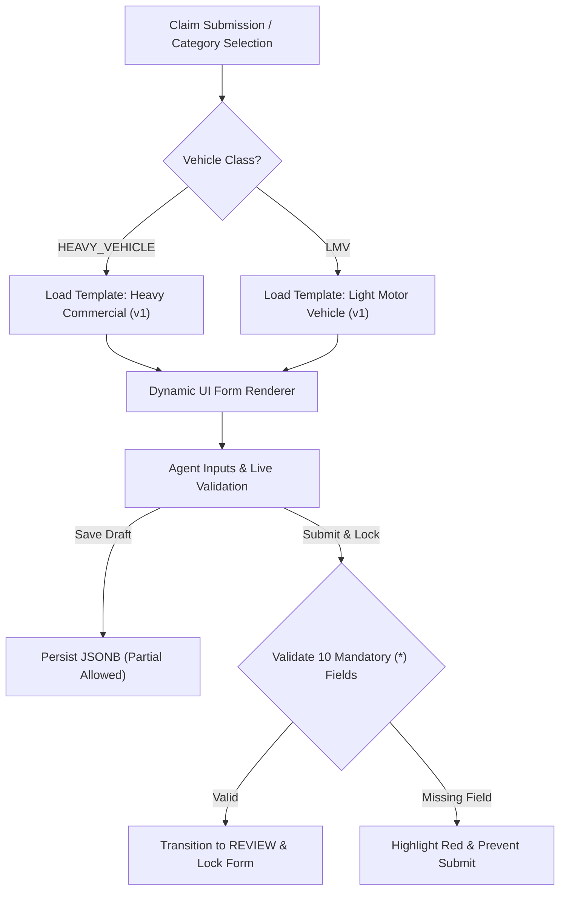
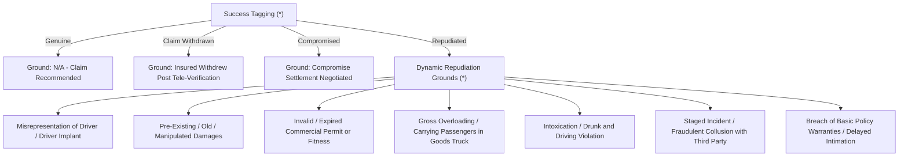

# 📋 08. Dossier Observation Engine and Dynamic Templates

## 1. The Dynamic Observation Challenge & JSONB Architecture

Motor claim investigations cannot be reduced to a static relational table with fixed columns. Investigation requirements vary dramatically between vehicle classes:
* **Heavy Commercial Vehicles (HGV)**: Require scrutiny of Gross Vehicle Weight (GVW), weighbridge slips, national/state permits, cleaner/helper statements, and driver commercial badges.
* **Light Motor Vehicles (LMV)**: Require scrutiny of private driver relations, family occupants, Google Maps timeline corroboration, and private garage estimates.

### Scalability Hook #1: JSONB Backed Templates

Instead of running destructive SQL migrations whenever an insurer requests a new field, the platform stores observations in a validated **PostgreSQL JSONB column** governed by an `observation_templates` schema:



---

## 2. The 10 Compulsory Investigation Fields (`*`)

Every completed investigation must answer the following 10 structured observation sections before it can be submitted for QA review:

| # | Field Key | Display Name | Heavy Vehicle Context | LMV Context |
|---|---|---|---|---|
| **1** | `insured_version` | Insured Version * | Owner statement on trip dispatch, cargo manifest | Owner statement on vehicle usage, keys custody |
| **2** | `driver_version` | Driver Version * | Commercial driver's account of road trip, mechanical failure, speed | Private driver's narrative of accidental impact |
| **3** | `occupant_cleaner_version` | Pillion / Occupant / Cleaner Version * | Statement of cleaner/helper regarding load and driver sobriety | Statement of family members, passengers, or pillion rider |
| **4** | `relation_with_insured` | Relation with Insured / Driver * | Salaried employee, subcontractor, or unrelated hired driver | Relative, friend, self-driven, or paid domestic driver |
| **5** | `kyc_documents` | KYC Documents Contacted * | Aadhaar, Commercial Badge DL, Voter ID of driver & cleaner | Aadhaar, Smart Card DL of driver & insured |
| **6** | `profession_contacted` | Profession of Persons Contacted * | Fleet operator, cargo agent, inter-state commercial driver | Business person, IT employee, student, mechanic |
| **7** | `hospital_injury_remarks` | Hospital / Injury Remarks * | Medico-Legal Certificate (MLC), cleaner injuries, third-party injuries | Local hospital emergency admission notes, doctor statement |
| **8** | `damages_garage_remarks` | Damages & Garage Remarks * | Cabin crush, chassis twist, cargo leakage, garage estimate check | Bumper, fender, headlight, airbag deployment vs. old dents |
| **9** | `social_media_news` | Social Media / News * | Local highway accident reports, regional newspaper coverage | Social media posts timestamped to accident night |
| **10** | `evidences_remarks` | Evidences Remarks * | Corroboration of weighbridge slips, GPS telematics, toll receipts | Fastag logs, CCTV footage, dashcam, WhatsApp chats |

---

## 3. Header Summary Observation Keys

The Dossier Header automatically displays 7 quick-status pills that provide instantaneous insight for QA Managers:

```json
{
  "obs_dl_status": "VALID_COMMERCIAL_BADGE",
  "obs_call_details": "TELE_VERIFICATION_RECORDED_OK",
  "obs_gallery_whatsapp": "DAMAGE_PHOTOS_RECEIVED",
  "obs_google_timeline": "MATCHED_ACCIDENT_LOCATION",
  "obs_rc_remarks": "GOODS_CARRIER_ACTIVE",
  "obs_policy_remarks": "COVERED_AT_LOSS_TIMESTAMP",
  "obs_fir_gd_compromise": "GD_ENTRY_VERIFIED"
}
```

---

## 4. Final Conclusion & Repudiation Grounds Taxonomy

When closing a dossier, the platform enforces cascading validation based on **Success Tagging**:



---

## 5. Dynamic JSON Schema Specification

Stored in `observation_templates.fields_schema`:

```json
{
  "$schema": "https://json-schema.org/draft/2020-12/schema",
  "title": "HeavyCommercialVehicleObservationTemplate",
  "type": "object",
  "required": [
    "insured_version",
    "driver_version",
    "occupant_cleaner_version",
    "relation_with_insured",
    "kyc_documents",
    "profession_contacted",
    "hospital_injury_remarks",
    "damages_garage_remarks",
    "social_media_news",
    "evidences_remarks",
    "cleaner_statement",
    "weighbridge_slip_verified",
    "permit_validity_state"
  ],
  "properties": {
    "insured_version": { "type": "string", "minLength": 20 },
    "driver_version": { "type": "string", "minLength": 20 },
    "occupant_cleaner_version": { "type": "string", "minLength": 10 },
    "relation_with_insured": { "type": "string" },
    "kyc_documents": { "type": "string" },
    "profession_contacted": { "type": "string" },
    "hospital_injury_remarks": { "type": "string" },
    "damages_garage_remarks": { "type": "string" },
    "social_media_news": { "type": "string" },
    "evidences_remarks": { "type": "string" },
    "cleaner_statement": { "type": "string" },
    "weighbridge_slip_verified": { "type": "boolean" },
    "permit_validity_state": { "type": "string", "enum": ["VALID", "EXPIRED", "NO_PERMIT", "UNAUTHORIZED_ROUTE"] }
  }
}
```

---

## 6. Next Steps & Connected Knowledge

* To see how these observation findings are formatted into the legal dossier, read [[09_Tamper_Evident_PDF_and_Dossier_Generation]].
* To see how the UI renders these 10 fields, inspect Section 6 in [[04_Cases_Vault_and_Dossier_UI_Specification]].
* For database schema mapping, see [[05_Database_Schema_and_Entity_Relationships]].
