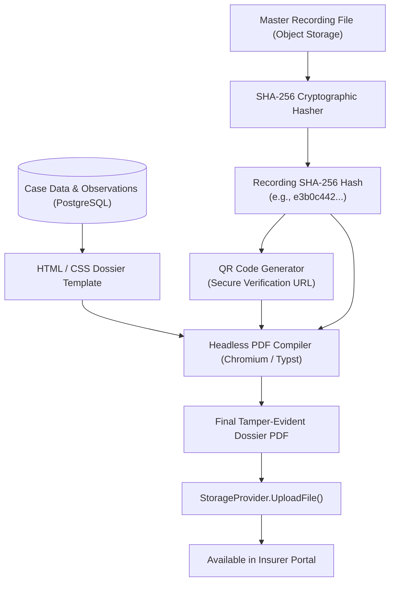
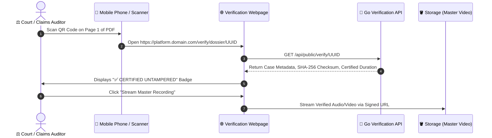

# 📑 09. Tamper-Evident PDF and Dossier Generation

## 1. Overview & Legal Defensibility

The final deliverable of an insurance investigation is the **Certified Dossier PDF**. Because this document is submitted to insurance claims committees and presented in court (such as Motor Accident Claims Tribunals - MACT), it must satisfy strict legal standards of tamper evidence, cryptographic chain of custody, and undeniable auditability.



---

## 2. Dossier PDF Document Architecture

The generated PDF follows a standardized 6-page investigative dossier structure:

### Page 1: Executive Cover & Cryptographic Verification Certificate
* **Investigation Agency & Insurer Details**: Official logos, case reference number, insurer claim number.
* **Cryptographic Verification Box**:
  * **Master Video SHA-256 Checksum**: 64-character hexadecimal hash.
  * **Verification QR Code**: Scannable code pointing directly to `https://platform.domain.com/verify/dossier/:verification_uuid`.
  * **Digital Generation Timestamp**: Formatted in IST: `14-Oct-2026 15:45:20 IST (UTC+05:30)`.
* **Investigation Outcome Summary**: Big status pill (`RECOMMENDED FOR REPUDIATION` or `GENUINE`).
* **Commercial Sign-Off Stamp**: Signatures of Agent, QA Manager, and Managing Director.

### Page 2: Case Profile, Policy & Incident Verification
* Vehicle Registration, Chassis No, Engine No, Make, Model, Manufacturing Year.
* Policy Number, Period of Insurance, Sum Insured / IDV (₹), Commercial Vehicle Permit No.
* Incident Date & Time, State, District, Exact GPS Coordinates of Alleged Loss.
* Insurer's Initial Suspicion Trigger Narrative.

### Page 3: Tele-Verification Call Log & Contact Directory
* Complete table of all phone calls and WhatsApp sessions attempted by the investigator.
* Contact Name, Relationship, Verified Phone Number, Call Disposition, Timestamp (IST), Duration (`MM:SS`).
* Cumulative Tele-Verification Billable Runtime (e.g., `00h 20m 24s`).

### Page 4: Structured Observation Findings (The 10 Fields)
* The 10 compulsory observation findings clearly laid out:
  1. Insured Version
  2. Driver Version
  3. Pillion Rider / Occupant / Cleaner Version
  4. Relation with Insured / Driver
  5. KYC Documents Verified
  6. Profession of Contacted Parties
  7. Hospital & Medico-Legal Remarks
  8. Damages vs. Garage Estimate Remarks
  9. Social Media & News Verification
  10. Supplemental Evidence & Fastag/Toll/GPS Remarks

### Page 5: Live Call Screenshot Gallery
* 2x2 grid of high-resolution video frame snapshots taken live during the WhatsApp call.
* Each screenshot includes:
  * Video Timestamp Offset (`+04m 12s`).
  * Capture Timestamp in IST.
  * Investigator Caption (e.g., *"Driver showing odometer and chassis punch plate"*).

### Page 6: Final Conclusion & Repudiation Grounds
* Primary Conclusion and Detailed Findings Narrative.
* Identified Grounds of Repudiation (if applicable) with cross-references to policy conditions.
* Investigator Affidavit & Non-Collusion Declaration.

---

## 3. Critical Timezone Formatting Mandate (Trap #6 Mitigation)

> [!IMPORTANT]
> **Timezone Rule**: In the database, all timestamps are stored in pure UTC (`TIMESTAMPTZ`). During PDF generation, the rendering engine must explicitly parse UTC and render in Indian Standard Time (`IST / UTC+05:30`).

```go
package pdf

import (
    "time"
)

var istLocation *time.Location

func init() {
    var err error
    istLocation, err = time.LoadLocation("Asia/Kolkata")
    if err != nil {
        // Fallback to fixed offset UTC+05:30
        istLocation = time.FixedZone("IST", 5*3600+30*60)
    }
}

// FormatToIST formats any UTC timestamp to legally defensible Indian Standard Time
func FormatToIST(t time.Time) string {
    return t.In(istLocation).Format("02-Jan-2006 15:04:05 IST (UTC+05:30)")
}

// FormatDuration formats raw seconds into human-readable billing time
func FormatDuration(seconds int) string {
    h := seconds / 3600
    m := (seconds % 3600) / 60
    s := seconds % 60
    return fmt.Sprintf("%02dh %02dm %02ds", h, m, s)
}
```

---

## 4. Verification QR Code & Public Validation Endpoint

Anyone possessing the physical or digital PDF can scan the embedded QR code to verify authenticity against the platform's public cryptographic ledger:



---

## 5. Next Steps & Connected Knowledge

* For how recording call durations are transformed into financial invoices, read [[10_Commercial_Metrics_and_Insurer_Billing]].
* For details on the background worker compiling this PDF, see [[07_Background_Processing_and_Queue_Architecture]].
* For the 6 golden rules governing PDF generation and timezones, see [[11_The_6_Architectural_Pillars_and_Trap_Mitigations]].
