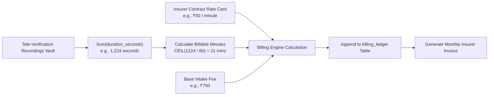

# 💰 10. Commercial Metrics and Insurer Billing

## 1. Commercial Model & Billing Mechanics

Investigation agencies operate on commercial contracts with insurance companies based on:
1. **Per-Minute Tele-Verification Billing**: Investigators charge a contractual rate per minute of tele-verification call time (e.g., ₹45/minute for LMV claims, ₹65/minute for Heavy Commercial Vehicles).
2. **Fixed Base Investigation Fee**: A standard intake and dossier preparation fee per case (e.g., ₹500 - ₹1,500).
3. **Turnaround Time (TAT) SLA Incentives / Penalties**: Bonuses for closing cases within 48 hours; penalties if cases exceed 15 days aging.



---

## 2. Integer Seconds & Ceiling Calculation Rule (Trap #6 Alignment)

> [!IMPORTANT]
> **No Floating Point Drift in Durations**: Recording durations must **never** be stored as floating point numbers (e.g., `20.4 minutes`). Durations are strictly persisted as **integers in seconds** (`recording_duration_seconds: 1224`).

### Go Calculation Logic

```go
package billing

import (
    "math"
    "github.com/shopspring/decimal"
)

type BillingSummary struct {
    RawSeconds        int             `json:"raw_seconds"`
    BillableMinutes   int             `json:"billable_minutes"`
    RatePerMinuteINR  decimal.Decimal `json:"rate_per_minute_inr"`
    BaseFeeINR        decimal.Decimal `json:"base_fee_inr"`
    TotalAmountINR    decimal.Decimal `json:"total_amount_inr"`
}

func CalculateCaseBilling(rawSeconds int, ratePerMin decimal.Decimal, baseFee decimal.Decimal) BillingSummary {
    // Contractual standard: round up partial minutes
    billableMinutes := int(math.Ceil(float64(rawSeconds) / 60.0))
    if billableMinutes < 1 && rawSeconds > 0 {
        billableMinutes = 1
    }

    callCost := ratePerMin.Mul(decimal.NewFromInt(int64(billableMinutes)))
    total := callCost.Add(baseFee)

    return BillingSummary{
        RawSeconds:       rawSeconds,
        BillableMinutes:  billableMinutes,
        RatePerMinuteINR: ratePerMin,
        BaseFeeINR:       baseFee,
        TotalAmountINR:   total,
    }
}
```

---

## 3. Commercial Metrics Dashboard (Admin Persona Only)

Accessible strictly to users with the `ADMIN` role (see [[02_User_Roles_and_RBAC_Matrix]]), the Commercial Metrics view provides financial command:

```
+----------------------------------------------------------------------------------------------------+
| COMMERCIAL METRICS & REVENUE LEDGER (OCTOBER 2026)                               [Export GST Excel]|
+----------------------------------------------------------------------------------------------------+
| Total Billable Mins: 14,820 Mins   | Total Unbilled Cases: 48   | Gross Billed (MTD): ₹8,42,500    |
| Avg Call Time / Case: 18M 45S      | Avg Realization / Min: ₹48 | Projected Revenue:  ₹12,60,000   |
+----------------------------------------------------------------------------------------------------+
| Insurer Partner      | Total Cases | Total Recorded Time | Billable Mins | Rate/Min | Billed Total |
|----------------------+-------------+---------------------+---------------+----------+--------------|
| ICICI Lombard        | 84          | 27h 12m 40s         | 1,633 Mins    | ₹50.00   | ₹1,44,150    |
| Bajaj Allianz GIC    | 62          | 19h 45m 10s         | 1,186 Mins    | ₹45.00   | ₹1,00,870    |
| Tata AIG Motor       | 51          | 16h 04m 22s         | 965 Mins      | ₹55.00   | ₹94,075      |
+----------------------------------------------------------------------------------------------------+
```

---

## 4. Insurer Client Portal Invoicing View

Insurers access a read-only billing portal isolated to their organization (`WHERE insurer_id = :user_insurer_id`):
* **Itemized Claim Breakdown**: Each row contains the Claim Number, Insured Name, Date of Submission, Total Recorded Seconds, Billable Minutes, and Direct Link to the Certified PDF Dossier.
* **Audit Transparency**: If an insurer disputes a 24-minute call charge, they can click directly to the verified recording stream and inspect the SHA-256 tamper-proof certificate.

---

## 5. Next Steps & Connected Knowledge

* For details on the 6 foundational rules preventing billing errors, see [[11_The_6_Architectural_Pillars_and_Trap_Mitigations]].
* For database schema definitions of `billing_ledger` and `insurers`, see [[05_Database_Schema_and_Entity_Relationships]].
* For role-based restrictions protecting commercial data, see [[02_User_Roles_and_RBAC_Matrix]].
