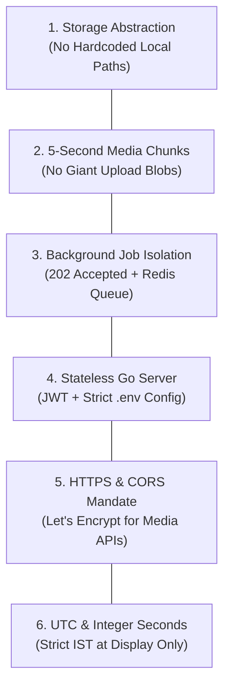
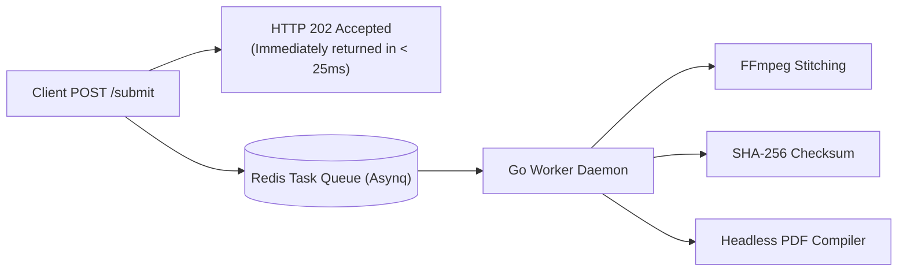

# 🛡️ 11. The 6 Critical Architectural Pillars and Trap Mitigations

This document outlines the **6 Non-Negotiable Engineering Pillars** for the platform. Violating any of these 6 rules during either the demo or production phase will lead to architectural rewrites, data loss, browser tab crashes, client billing disputes, or total deployment failure.



---

## Pillar 1: The Storage Abstraction Trap (Never Hardcode Local File Paths)

### The Trap
When building initial prototypes or demos, developers frequently write code like:
```go
// ❌ WRONG: Destructive Anti-Pattern
ioutil.WriteFile("/uploads/" + filename, data, 0644)
```
Or in Node/Go, storing file paths as `/var/app/uploads/evidence.pdf` in the database. When the application is subsequently containerized with Docker, deployed to a read-only serverless environment, or moved to cloud object storage (AWS S3, Cloudflare R2), every single file controller and file query breaks.

### The Rule: Build a Simple Storage Interface from Day 1

```go
package storage

import (
    "context"
    "io"
    "time"
)

// StorageProvider abstracts underlying object persistence
type StorageProvider interface {
    // UploadFile streams data to the given storage path/key
    UploadFile(ctx context.Context, file io.Reader, path string) (url string, err error)
    
    // DownloadFile retrieves a stream for reading
    DownloadFile(ctx context.Context, path string) (io.ReadCloser, error)
    
    // GetSignedURL generates a time-limited pre-signed URL for direct browser streaming
    GetSignedURL(ctx context.Context, path string, expiry time.Duration) (string, error)
    
    // DeleteFile removes an object by key
    DeleteFile(ctx context.Context, path string) error
}
```

### Implementations:
1. **Demo / Local Dev**: Use `MinIOStorageProvider` (an S3-compatible local Docker container) or `LocalStorageProvider` implementing the same interface.
2. **Production**: Use `S3StorageProvider` (AWS S3) or `R2StorageProvider` (Cloudflare R2).
* **The Benefit**: Your Go HTTP handlers and database records store only abstract keys (e.g., `cases/MOT18221241/chunks/chunk_001.webm`). Switching between local MinIO and AWS S3 requires changing **only one configuration string in `.env`**—not a single line of business code changes.

---

## Pillar 2: The Browser Media Recording Chunks Trap

### The Trap
Developers use the browser's `MediaRecorder` API and wait for the recording to finish before sending the payload:
```javascript
// ❌ WRONG: RAM Explosion & Wi-Fi Catastrophe
recorder.onstop = () => {
    const giantBlob = new Blob(allChunks);
    uploadBlob(giantBlob); // 500MB payload!
};
```
On localhost, sending a 500 MB mock file in one shot succeeds. In real life, a **2-hour tele-verification call** over unstable 4G/Wi-Fi will:
* Consume 1 GB+ of RAM in Chrome, causing low-spec investigator laptops to crash or freeze.
* Result in an HTTP timeout on the reverse proxy (Nginx `client_max_body_size` or 60s gateway timeout).
* If the investigator accidentally closes the browser tab at minute 118, **all 118 minutes of evidence are lost forever**.

### The Rule: Configure 5-Second Slices (`recorder.start(5000)`)
* Configure the frontend recorder with 5-second intervals:
  ```javascript
  // ✅ CORRECT: Sequential 5-Second Slices
  recorder.start(5000); 
  recorder.ondataavailable = (e) => stageAndUploadChunk(e.data);
  ```
* The frontend streams or stages chunks sequentially to `/api/cases/:id/recordings/:recId/chunks`.
* If the browser tab crashes after 1 hour, **720 chunks are already safely persisted in object storage**. Only the last 5 seconds are at risk.

---

## Pillar 3: Background Job Isolation (Video Hashing & PDF Rendering)

### The Trap
Running video concatenation (`ffmpeg`), SHA-256 cryptographic checksum calculation, and headless PDF compilation synchronously inside an HTTP handler:
```go
// ❌ WRONG: Freezes HTTP Server Thread
func SubmitCase(c *gin.Context) {
    exec.Command("ffmpeg", ...).Run() // Blocks for 45 seconds!
    generatePDF()                     // Blocks for 10 seconds!
    c.JSON(200, "Done")
}
```
If two agents submit cases simultaneously, running FFmpeg and PDF compilation on the main web server process consumes 100% of CPU cores, causing all incoming API requests to queue and freezing the dashboard for every user.

### The Rule: Decouple via Queue & Return `202 Accepted`

* The HTTP route immediately returns `202 Accepted` (`status: "PROCESSING"`).
* A background worker (`hibiken/asynq` with Redis, or an in-memory buffered worker pool for demo) executes concatenation, hashing, and PDF generation asynchronously with controlled concurrency.

---

## Pillar 4: Stateless Go Server & Environment Variables

### The Trap
* Storing sessions, active call states, or temporary files in Go server memory (`sync.Map`, global slices) or local `/tmp`.
* Hardcoding ports, database connection strings, or JWT secrets in Go code.

### The Rule: 100% Stateless Server & Strict `.env` Configuration
1. **Stateless Authentication**: Use cryptographic JWT bearer tokens containing `user_id`, `role`, and `tenant_id`. No server-side session tables in memory.
2. **Ephemeral File System**: Workers using temporary files must use `os.MkdirTemp` and execute `defer os.RemoveAll(scratchDir)`.
3. **100% Config via `.env`**: Every setting is retrieved via `os.Getenv()`:
   * `DB_DSN`, `REDIS_ADDR`, `STORAGE_DRIVER`, `S3_BUCKET`, `JWT_SECRET`, `PORT`, `CORS_ALLOWED_ORIGINS`.
* **Why it matters**: A stateless Go server can be deployed on a single $10 VPS or scaled horizontally across 10 Kubernetes pods behind a load balancer without changing a single line of session code.

---

## Pillar 5: Cross-Origin (CORS) & Browser Media Permissions

### The Trap
* Testing on `localhost:3000` and `localhost:8080` with wide-open CORS (`AllowAllOrigins: true`) and unencrypted HTTP.
* Deploying a staging demo to a remote IP (`http://139.59.x.x:3000`) and discovering that the browser blocks the screen and microphone sharing entirely!

### The Rule: HTTPS is Mandatory for `getUserMedia` and `getDisplayMedia`
Modern browsers (Chrome, Edge, Firefox, Safari) enforce strict security policies:
> [!CAUTION]
> Browser APIs for screen recording (`navigator.mediaDevices.getDisplayMedia`) and microphone recording (`navigator.mediaDevices.getUserMedia`) **STRICTLY REQUIRE AN HTTPS ORIGIN**. The only exception browsers grant is `http://localhost`.

* **For Client Staging Demos**: You **cannot** demonstrate the live WhatsApp tele-verification on an unencrypted IP (`http://x.x.x.x`). You **must** attach a domain name (or free DuckDNS/Cloudflare tunnel) with a valid SSL certificate (Let's Encrypt).
* **Strict CORS Policy**: Whitelist exact domain origins (e.g., `https://app.yourdomain.com`), and allow credentials for secure cookie/header transmission.

---

## Pillar 6: Timezones & Call Runtime Precision

### The Trap
* Storing local server timestamps for call start/stop times (e.g., `2026-10-19 15:30:00` without timezone offset).
* Storing durations as formatted strings (`"18 mins 24 secs"`) or floating-point minutes (`18.4`).

### The Rule: Pure UTC in Database, IST Only at Presentation
1. **All Database Timestamps in UTC (`TIMESTAMPTZ`)**:
   * Stored in PostgreSQL as `TIMESTAMPTZ` (stored internally as UTC).
   * Returned over JSON APIs as ISO 8601 strings (`2026-10-19T10:00:00Z`).
2. **Raw Durations Stored as Non-Negative Integers in Seconds**:
   * Example: `duration_seconds: 1104` (representing 18 minutes, 24 seconds).
3. **Presentation Conversion at Boundary Only**:
   * Conversion to Indian Standard Time (`IST / UTC+05:30`) and formatted strings (`18m 24s`) occurs **strictly** on the frontend React view or when compiling the final PDF dossier.
* **Why it matters**: Billing disputes with insurance companies hinge on exact per-minute runtimes. Integer seconds and UTC eliminate timezone drift, daylight saving bugs, and rounding discrepancies.

---

## 7. Next Steps & Connected Knowledge

* To see how these rules are applied in server and worker code, see [[06_Tele_Verification_and_Media_Recording_Pipeline]] and [[07_Background_Processing_and_Queue_Architecture]].
* To configure Nginx, SSL, and environment variables for deployment, see [[14_Hosting_Infrastructure_and_Deployment_Guide]].
* To follow the phased implementation plan enforcing these pillars, see [[15_Complete_Development_Lifecycle_and_Roadmap]].
