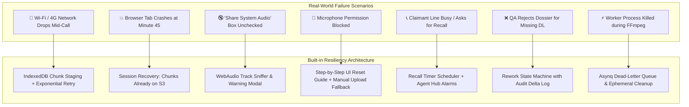

# 🛡️ 13. Edge Cases and Failure Recovery Strategies

In real-world motor insurance investigations, field conditions are chaotic: investigators experience unstable 4G mobile hotspots, claimants hang up mid-call, browser tabs crash, and audio permissions are accidentally denied. This document details the resilience patterns built into the platform.



---

## 1. Failure Scenario 1: Wi-Fi / 4G Network Drop Mid-Call

### The Risk
The investigator is 30 minutes into a tele-verification call with a truck driver on a highway. The investigator's mobile hotspot fluctuates or disconnects for 2 minutes.

### The Mitigation
* The browser `MediaRecorder` continues slicing 5-second chunks in memory.
* Chunks are staged into an **IndexedDB** local queue on the investigator's machine.
* The frontend network worker monitors `navigator.onLine` and HTTP response codes.
* When the connection returns, staged chunks are pushed sequentially (`chunk_0142`, `chunk_0143`, `chunk_0144`) with exponential retry backoff.
* The backend acknowledges each chunk by index, guaranteeing no chunk is lost or duplicated.

---

## 2. Failure Scenario 2: Browser Tab Crash or Accidental Close

### The Risk
The investigator accidentally closes Chrome or their laptop runs out of battery 40 minutes into a call.

### The Mitigation
* Because chunks were streamed every 5 seconds (see [[11_The_6_Architectural_Pillars_and_Trap_Mitigations|Rule 2]]), **all 480 chunks up to the crash already reside in object storage**.
* When the investigator re-opens the dashboard, the system detects a recording in `STREAMING` status for that case.
* The UI presents a prompt:
  > *"An unclosed recording session (MOT18221241 - 40m 15s) was detected. Would you like to **Finalize & Save** or **Resume**?"*
* Clicking **Finalize** marks the recording ready for stitching; the 40 minutes of evidence and billable duration are 100% saved.

---

## 3. Failure Scenario 3: System Audio Missing ("Also share audio" unchecked)

### The Risk
When Chrome prompts `getDisplayMedia`, the agent selects the WhatsApp tab but forgets to check the small checkbox: *"Also share tab audio"*. As a result, the recording captures the agent's voice but the claimant's responses are completely silent.

### The Mitigation
* The frontend audio mixer immediately analyzes the `getDisplayMedia` stream:
  ```typescript
  if (displayStream.getAudioTracks().length === 0) {
    // Audio track missing!
    triggerAudioWarningToast(
      "⚠️ Remote Audio Warning: You did not check 'Also share tab audio' in the browser prompt. The claimant's voice will NOT be recorded! Please click Re-capture."
    );
  }
  ```
* A non-blocking amber warning banner appears at the top of the recorder toolbar so the agent can restart capture before starting the interrogation.

---

## 4. Failure Scenario 4: Microphone Permission Denied

### The Risk
The investigator clicked "Block" on the browser microphone permission dialog.

### The Mitigation
1. The platform catches the `NotAllowedError` exception.
2. An interactive dialog renders with clear browser-specific instructions:
   * *"Click the padlock icon 🔒 in the Chrome address bar."*
   * *"Toggle Microphone from 'Block' to 'Allow'."*
   * *"Click Reload."*
3. If hardware issues persist, the agent can use the **Upload Recording** fallback button to upload an external recording file (`.mp4`, `.webm`, `.m3a`).

---

## 5. Failure Scenario 5: Line Busy / Recall Timers

### The Risk
Investigators call 50 truck drivers a day; 60% of lines are busy, switched off, or ask for a callback in 30 minutes. Without tracking, leads are lost and case turnaround time (TAT) breaches SLAs.

### The Mitigation
* Investigator logs call disposition: `LINE_BUSY` or `ASKED_FOR_CALLBACK`.
* Agent selects a **Recall Timer**: `15M`, `30M`, `1H`, `2H`, `4H`, `1D`, or `CUSTOM`.
* The server stores `recall_at` in UTC in the `call_logs` table.
* The frontend's persistent WebSocket/SSE heartbeat checks due recalls and displays a desktop push notification and flashing counter on the **Agent Hub** tab when the recall is due.

---

## 6. Failure Scenario 6: QA Rejection & Rework Loop

### The Risk
A Manager reviews a dossier and notices the Driving License image is illegible or the cleaner statement is missing.

### The Mitigation
* Manager clicks **Reject to WIP** and enters mandatory rejection remarks.
* Case transitions back to `WORK_IN_PROGRESS` with a visual `REWORK` pill.
* The assigned agent receives an instant notification with the Manager's exact notes.
* The agent edits only the deficient fields and re-submits without losing any prior recordings or observation data.
* A record is appended to `case_audit_logs` tracking the rework cycle for operational quality metrics.

---

## 7. Failure Scenario 7: Worker Killed During Video Stitching

### The Risk
The server host is restarted or runs low on memory while FFmpeg is stitching a 2-hour recording.

### The Mitigation
* `hibiken/asynq` uses Redis task leases and automatic retries (`asynq.MaxRetry(3)`).
* If the worker crashes mid-concatenation, the task lease expires and another worker instance picks up the job.
* Workers use isolated scratch directories (`os.MkdirTemp`) with `defer os.RemoveAll()`, ensuring half-written temporary files never fill up the disk.
* If all 3 retries fail, the task enters the **Dead Letter Queue (DLQ)** and alerts the Admin dashboard for manual inspection.

---

## 8. Next Steps & Connected Knowledge

* For hosting and server infrastructure designed to withstand these edge cases, proceed to [[14_Hosting_Infrastructure_and_Deployment_Guide]].
* For the full development lifecycle to implement these resilience checks, see [[15_Complete_Development_Lifecycle_and_Roadmap]].
