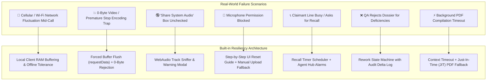

# 🛡️ 13. Edge Cases and Failure Recovery Strategies

In real-world motor insurance investigations, field conditions are chaotic: investigators experience unstable 4G mobile hotspots, claimants hang up mid-call, browser tabs crash, and audio permissions are accidentally denied. This document details the resilience patterns built into the platform.



---

## 1. Failure Scenario 1: Cellular / Wi-Fi Network Fluctuation Mid-Call

### The Risk
The investigator is 15 minutes into a tele-verification call with a truck driver on a highway. The investigator's mobile hotspot fluctuates or drops intermittently.

### The Mitigation
* The browser's `MediaRecorder` runs **entirely client-side** in browser memory (`recordedChunksRef.current`). It does not depend on continuous server streaming.
* Temporary network drops affect WhatsApp connectivity, but the browser recording engine continues capturing whatever is rendered and heard locally.
* When the call concludes, the agent stops the recorder. If the agent's network is offline at that exact moment, the frontend retains the assembled video blob in memory and provides a retry prompt or the ability to save the WebM locally.
* Because the platform dropped the 5-second chunking approach (which would have failed and fragmented on spotty networks), there are no dropped intermediate chunks or out-of-order stitching errors.

---

## 2. Failure Scenario 2: 0-Byte WebM File / Accidental Stop

### The Risk
Eagerly invoking `recorder.stop()` without waiting for media codecs to finish encoding can cause the browser to generate an empty 0-byte WebM blob, resulting in lost evidence.

### The Mitigation
* **Forced Buffer Flush**: Before triggering stop, the frontend invokes `mediaRecorder.requestData()`. This forces the browser hardware encoder to flush all buffered video/audio frames into the accumulator.
* **Stop Event Resolution**: The frontend wraps `recorder.onstop` inside a Promise, ensuring the final WebM blob is created only after all encoding events have resolved.
* **Size Validation**: The frontend checks `fullBlob.size > 0`. If 0 bytes are detected, an error is surfaced immediately.
* **Backend Guard**: The Go backend rejects empty files (`if fileHeader.Size == 0`) with `400 Bad Request`.
* **Offline Recording Fallback**: If an agent experiences hardware issues or uses external recording software, they can use the **Upload Recording** fallback button (`POST /api/v1/cases/:id/recordings/upload`) to upload `.mp4`, `.webm`, or `.m4a` files.

---

## 3. Failure Scenario 3: System Audio Missing ("Also share audio" unchecked)

### The Risk
When Chrome prompts `getDisplayMedia`, the agent selects the WhatsApp tab but forgets to check the small checkbox: *"Also share tab audio"*. As a result, the recording captures the agent's voice but the claimant's responses are completely silent.

### The Mitigation
* The frontend audio mixer immediately analyzes the `getDisplayMedia` stream:
  ```typescript
  if (displayStream.getAudioTracks().length === 0) {
    // Audio track missing!
    triggerAudioWarningToast(
      "⚠️ Remote Audio Warning: You did not check 'Also share tab audio' in the browser prompt. The claimant's voice will NOT be recorded! Please click Re-capture."
    );
  }
  ```
* A non-blocking amber warning banner appears at the top of the recorder toolbar so the agent can restart capture before starting the interrogation.

---

## 4. Failure Scenario 4: Microphone Permission Denied

### The Risk
The investigator clicked "Block" on the browser microphone permission dialog.

### The Mitigation
1. The platform catches the `NotAllowedError` exception.
2. An interactive dialog renders with clear browser-specific instructions:
   * *"Click the padlock icon 🔒 in the Chrome address bar."*
   * *"Toggle Microphone from 'Block' to 'Allow'."*
   * *"Click Reload."*
3. If hardware issues persist, the agent can use the **Upload Recording** fallback button to upload an external recording file (`.mp4`, `.webm`, `.m3a`).

---

## 5. Failure Scenario 5: Line Busy / Recall Timers

### The Risk
Investigators call 50 truck drivers a day; 60% of lines are busy, switched off, or ask for a callback in 30 minutes. Without tracking, leads are lost and case turnaround time (TAT) breaches SLAs.

### The Mitigation
* Investigator logs call disposition: `LINE_BUSY` or `ASKED_FOR_CALLBACK`.
* Agent selects a **Recall Timer**: `15M`, `30M`, `1H`, `2H`, `4H`, `1D`, or `CUSTOM`.
* The server stores `recall_at` in UTC in the `call_logs` table.
* The frontend's persistent WebSocket/SSE heartbeat checks due recalls and displays a desktop push notification and flashing counter on the **Agent Hub** tab when the recall is due.

---

## 6. Failure Scenario 6: QA Rejection & Rework Loop

### The Risk
A Manager reviews a dossier and notices the Driving License image is illegible or the cleaner statement is missing.

### The Mitigation
* Manager clicks **Reject to WIP** and enters mandatory rejection remarks.
* Case transitions back to `WORK_IN_PROGRESS` with a visual `REWORK` pill.
* The assigned agent receives an instant notification with the Manager's exact notes.
* The agent edits only the deficient fields and re-submits without losing any prior recordings or observation data.
* A record is appended to `case_audit_logs` tracking the rework cycle for operational quality metrics.

---

## 7. Failure Scenario 7: Asynchronous Background Dossier Generation Timeout or Failure

### The Risk
The server host is restarted, runs out of memory, or experiences a transient storage timeout while compiling the tamper-evident PDF dossier after Admin Sign-Off.

### The Mitigation
* **Context Timeout Protection**: Asynchronous completer tasks run with strict `context.WithTimeout(ctx, 2*time.Minute)` to prevent stuck zombie goroutines.
* **Just-In-Time (JIT) Generation Fallback**: When an Auditor, Manager, or Insurer attempts to download the dossier (`GET /api/v1/cases/:id/pdf/download`), the backend inspects `case.LockedPDFPath`. If the dossier was not yet generated (e.g., due to a temporary background interruption), the handler invokes `pdfGenerator.CompileDossier()` on-demand, generates the certified report synchronously, updates the database, and streams the dossier immediately.
* **Multi-Node Deployment Resilience**: In optional multi-node deployments utilizing the `asynq` worker daemon, tasks use Redis leases with exponential backoff (`asynq.MaxRetry(3)`) and dead-letter queue (DLQ) alerts. Workers always execute temporary scratch directory cleanup via `defer os.RemoveAll(scratchDir)`.

---

## 8. Next Steps & Connected Knowledge

* For hosting and server infrastructure designed to withstand these edge cases, proceed to [[14_Hosting_Infrastructure_and_Deployment_Guide]].
* For the full development lifecycle to implement these resilience checks, see [[15_Complete_Development_Lifecycle_and_Roadmap]].
