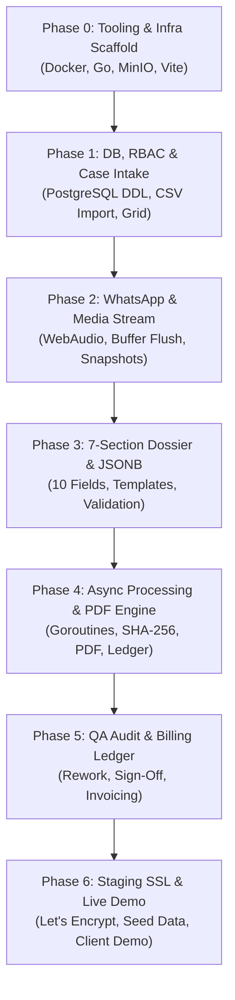

# 📅 15. Complete Development Lifecycle and Roadmap

This document provides a sequential, step-by-step engineering roadmap to develop, test, host, and demo the **Motor Claim Verification & Dossier Intelligence Platform** from scratch. 



---

## Phase 0: Tooling, Infrastructure & Storage Abstraction (Day 1–2)

### Goals
Establish the developer environment, container network, and storage interface to eliminate hardcoded path risks from Day 1.

### Developer Tasks
1. **Repository Layout**:
   ```
   ├── backend/             # Go REST API & Workers
   │   ├── cmd/api/         # Main HTTP server entry
   │   ├── cmd/worker/      # Optional Asynq worker daemon entry
   │   ├── internal/
   │   │   ├── auth/        # JWT middleware & RBAC
   │   │   ├── handlers/    # HTTP route controllers
   │   │   ├── models/      # GORM / SQL models
   │   │   ├── pdf/         # Dossier PDF generator
   │   │   ├── worker/      # Stitcher & async jobs
   │   │   └── storage/     # StorageProvider interface
   ├── frontend/            # React / TypeScript / Vite / Tailwind
   ├── docker-compose.yml   # Postgres, MinIO, API, Frontend, Nginx
   ├── nginx/               # Reverse proxy & SSL configs
   └── .env.example         # System configuration
   ```
2. **Storage Interface Implementation**:
   * Implement the `StorageProvider` interface in Go (see [[11_The_6_Architectural_Pillars_and_Trap_Mitigations|Rule 1]]).
   * Provide `MinIOStorageProvider` backed by MinIO S3 SDK, with `LocalStorageProvider` fallback.
3. **Container Bootstrap**:
   * Run `docker compose up -d postgres minio` to verify local services are healthy.

---

## Phase 1: Database Migrations, RBAC & Case Intake (Day 3–5)

### Goals
Implement the database schema, user authentication, and the Cases Vault data grid.

### Developer Tasks
1. **PostgreSQL Migrations**:
   * Execute the production DDL from [[05_Database_Schema_and_Entity_Relationships]].
   * Verify all timestamps use `TIMESTAMPTZ` and durations use integers.
2. **JWT & RBAC Middleware**:
   * Implement `/api/v1/auth/login` returning JWT claims.
   * Implement `RequireRole("ADMIN", "MANAGER", "AGENT", "INSURER")` middleware (see [[02_User_Roles_and_RBAC_Matrix]]).
3. **Intake Engine**:
   * Implement CSV/Excel bulk parser (`POST /api/v1/cases/bulk-import`).
   * Implement `+ Add Case` manual modal.
4. **Cases Vault Frontend Grid**:
   * Build the UI data table with vehicle switcher (`HEAVY_VEHICLE` vs `LMV`), status pills (`UNASSIGNED`, `WIP`, `REVIEW`, `COMPLETED`), aging calculator, and search filters (see [[04_Cases_Vault_and_Dossier_UI_Specification]]).

---

## Phase 2: WhatsApp Integration & Direct MediaRecorder Pipeline (Day 6–8)

### Goals
Build the in-browser tele-verification recording engine with permanent floating widgets, buffer flushing, and direct uploads.

### Developer Tasks
1. **WhatsApp Web Launcher**:
   * Implement the `WhatsApp Call` / `Chat & Record` trigger opening `https://web.whatsapp.com/send?phone=...`.
2. **Web Audio Mixer**:
   * Combine `getUserMedia` (microphone) and `getDisplayMedia` (tab audio) using Web Audio API (see [[06_Tele_Verification_and_Media_Recording_Pipeline]]).
   * Add warning banner if tab audio was not checked.
3. **Direct Recording with Forced Buffer Flush**:
   * Build independent floating pill widgets (`PermanentCallWidgets.tsx`) with pause/resume and timer.
   * Continuous buffer collection via `recorder.start(500)`.
   * Implement forced buffer flush via `recorder.requestData()` before stopping.
   * Build backend endpoint: `POST /api/v1/cases/:id/recordings/direct` with on-the-fly SHA-256 calculation (`io.TeeReader`).
   * Validate non-zero file sizes on client and server.
4. **Live Call Snapshot Tool**:
   * Implement dual-pipeline canvas/ImageCapture snapshot capture and upload to `/api/v1/cases/:id/screenshots`.
5. **Recall Timers & Contacts**:
   * Implement Sections 2 of Dossier Modal (contact directory & recall timers).

---

## Phase 3: Case Dossier Modal & Dynamic Observation Engine (Day 9–11)

### Goals
Implement the complete 7-Section Dossier Modal with dynamic JSONB validation.

### Developer Tasks
1. **Dossier Modal UI**:
   * Build the 7-section layout defined in [[04_Cases_Vault_and_Dossier_UI_Specification]].
2. **Dynamic JSONB Observation Engine**:
   * Load JSON schema templates based on vehicle class (`HEAVY_VEHICLE` vs `LMV`).
   * Render the 10 compulsory investigation fields (`*`).
   * Implement Header Observation Status Pills (`OBS DL Status`, `OBS Call Details`, etc.).
3. **Cascading Dropdowns**:
   * Link `Success Tagging` to dynamic `Ground of Repudiation` options (see [[08_Dossier_Observation_Engine_and_Dynamic_Templates]]).
4. **Draft vs Submit Logic**:
   * `Save as Draft`: updates JSONB without validation.
   * `Submit Report & Lock Case`: enforces all 10 mandatory fields, transitions case to `REVIEW`.

---

## Phase 4: Asynchronous Processing & Tamper-Evident PDF Engine (Day 12–14)

### Goals
Decouple CPU-heavy dossier generation using in-process Go goroutines; build cryptographic PDF generator.

### Developer Tasks
1. **Asynchronous Goroutine Completer**:
   * Set up asynchronous `asyncCompleter` function returning HTTP `202 Accepted` immediately upon Admin sign-off (see [[07_Background_Processing_and_Queue_Architecture]]).
   * Implement context timeouts (`context.WithTimeout(ctx, 2*time.Minute)`).
2. **Tamper-Evident PDF Compiler**:
   * Build HTML template embedding case metadata, call logs, 10 observation fields, and screenshots (see [[09_Tamper_Evident_PDF_and_Dossier_Generation]]).
   * Embed SHA-256 hash stamp and scannable verification QR code.
   * Render all timestamps in **IST (UTC+05:30)**.
   * Implement JIT generation fallback when downloading compiled dossier.
3. **Public Verification Page**:
   * Build `GET /api/v1/public/verify/dossier/:uuid` endpoint.

---

## Phase 5: QA Audit, Commercial Billing & Insurer Portal (Day 15–17)

### Goals
Complete the multi-level approval workflow and financial billing ledger.

### Developer Tasks
1. **Manager QA Audit View**:
   * Video playback modal with speed controls.
   * One-click **Approve** (moves to `ADMIN_SIGN_OFF`) or **Reject to WIP** (requires rejection remarks).
2. **Admin Commercial Sign-Off**:
   * Final duration review.
   * Trigger transition to `COMPLETED` and dispatch PDF compilation.
3. **Billing Ledger Engine**:
   * Implement integer second summation and `CEIL(duration / 60)` minute calculation (see [[10_Commercial_Metrics_and_Insurer_Billing]]).
   * Populate `billing_ledger` table with contractual rate cards.
4. **Insurer Client Portal**:
   * Isolated view for insurer accounts to download final PDF dossiers, stream verified recordings, and view billing invoices.

---

## Phase 6: Staging SSL Deployment & Client Demo Execution (Day 18–20)

### Goals
Deploy the system to a staging server with valid SSL/HTTPS to enable browser media APIs and conduct a flawless live demonstration.

### Developer Tasks
1. **Hosting & SSL Setup**:
   * Deploy `docker-compose.yml` to a VPS (see [[14_Hosting_Infrastructure_and_Deployment_Guide]]).
   * Configure Nginx with Let's Encrypt SSL certificate for `demo.yourdomain.com` (or Cloudflare Tunnel).
   * **Verify that Chrome grants screen and microphone permissions without HTTPS security errors.**
2. **Demo Seed Data**:
   * Seed 15 sample cases:
     * 5 `UNASSIGNED` (3 Heavy Vehicles, 2 LMV).
     * 5 `WORK_IN_PROGRESS` (with active recall timers and draft observations).
     * 3 `REVIEW` (ready for QA manager approval).
     * 2 `COMPLETED` (with verified video, SHA-256 hash, and downloadable PDF).
3. **Stakeholder Demo Walkthrough**:
   * Demonstrate bulk CSV intake.
   * Launch WhatsApp tele-verification call with permanent floating controls and direct video upload.
   * Take live video snapshots of vehicle damage.
   * Fill the 10 observation fields, select repudiation ground, and submit.
   * Log in as QA Manager, reject with note, rework as Agent, approve.
   * Log in as Admin, sign off, show 202 background job processing.
   * Download final PDF, scan QR code with phone, show verified untampered status.
   * Show Commercial Billing Ledger with exact per-minute calculation.

---

## 7. Next Steps & Connected Knowledge

* Start building Phase 0 by setting up the storage abstraction in [[11_The_6_Architectural_Pillars_and_Trap_Mitigations]].
* Refer to the database definitions in [[05_Database_Schema_and_Entity_Relationships]].
* Check the master index in [[00_Map_of_Content]].
