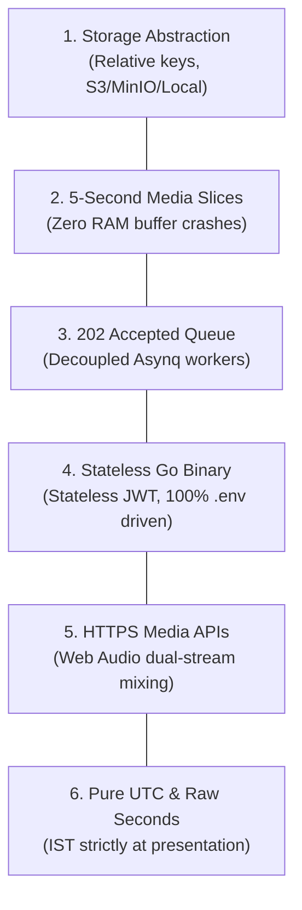

# 🛡️ Motor Claim Verification & Dossier Intelligence Platform
> **Production-Grade Tele-Verification, Dynamic Investigation Dossiers, and Tamper-Evident Legal Certification for Motor Insurers.**

[](https://golang.org)
[](https://react.dev)
[](https://www.typescriptlang.org)
[](https://www.postgresql.org)
[](https://redis.io)
[](https://min.io)
[](https://tailwindcss.com)

---

## 📖 1. What is This Platform?

The **Motor Claim Verification & Dossier Intelligence Platform** is an enterprise-grade SaaS designed for insurance Third-Party Administrators (TPAs) and motor insurers (e.g., ICICI Lombard, Bajaj Allianz, Tata AIG) handling **Commercial Heavy Goods Vehicles (HGV)** and **Light Motor Vehicles (LMV)** claims.

### Core Business Capabilities
1. **Intake & Triage**: High-throughput claim ingestion via bulk CSV spreadsheets or manual forms with automatic aging counters (`AGING: 2D`) and load-balanced agent allocation.
2. **In-Browser Tele-Verification via WhatsApp Web**: Investigators click **Chat & Record** to open WhatsApp Web and capture synchronized dual-stream audio (mic + tab) and screen recording directly in the browser.
3. **5-Second Streaming Slices**: Recordings are sliced and uploaded every 5 seconds (`recorder.start(5000)`) directly to object storage, preventing browser tab crashes and eliminating evidence loss on flaky 4G/Wi-Fi hotspots.
4. **Follow-Up Recall Timers**: Configurable alarms (`15M`, `30M`, `1H`, `2H`, `4H`, `1D`, `Custom`) for busy or rescheduled claimant lines, with overdue highlights in the Agent Hub.
5. **Dynamic JSONB Observation Engine**: 10 compulsory investigation fields (`*`) validated dynamically based on vehicle class (Heavy Trucks vs. Private Cars).
6. **Multi-Level QA Review & Rework Cycle**: QA Managers can approve claims or reject them back to `WORK_IN_PROGRESS` with mandatory deficiency notes.
7. **Tamper-Evident Certified Dossier PDF**: Headless generation of a legally certified 6-page report embedding IST timestamps (`UTC+05:30`), Master Video SHA-256 hash checksums, and a scannable public verification QR code.
8. **Commercial Invoicing Ledger**: Contractual per-minute tele-verification billing using exact integer-second ceiling arithmetic (`CEIL(duration / 60)`).

---

## ⚡ 2. The Bare Minimum to Run & Test (Quickest Path)

You do **not** need Docker installed or running to perform a quick local check. The backend has an automatic embedded database and local storage fallback.

### Step 1: Start the Go Backend (Terminal 1)
```bash
cd backend
go run ./cmd/api
```
- Automatically seeds 4 sample cases, 5 user accounts, and rate cards.
- Listens on `http://localhost:8080` (or `http://localhost:8089` if configured).
- Healthcheck: `curl http://localhost:8080/health`

### Step 2: Start the React Frontend (Terminal 2)
```bash
cd frontend
npm run dev
```
- Open `http://localhost:3000` in any modern web browser.
- Use the **1-Click Quick Persona Login** buttons on the login screen to test immediately!

### Step 3: Run the Automated End-to-End Test Suite
To automatically verify that all 8 critical operational workflows are 100% operational:
```bash
./scripts/test_e2e.sh
```
*(Runs authentication, RBAC filtering, case creation, 5s chunk streaming, observations validation, recall timers, and cryptographic QR verification).*

---

## 🚀 3. Running with Full Production Infrastructure (Docker)

To simulate the exact production environment targeting **AWS (EC2/ECS behind ALB)**:

### Option A: Complete Docker Compose Stack
```bash
# 1. Copy production environment variables
cp .env.example .env

# 2. Launch PostgreSQL 16, Redis, MinIO S3, Go API, Worker, React Frontend, and Nginx
docker compose up -d --build
```
- **Web Dashboard**: `http://localhost` (via Nginx proxy on Port 80)
- **MinIO Storage Console**: `http://localhost:9001` (User: `minioadmin`, Pass: `minioadminpassword123`)
- **PostgreSQL Database**: `localhost:5432` (DB: `motor_claims`)
- **Redis Queue**: `localhost:6379`

### Option B: Hybrid Development Mode (Recommended for Daily Dev)
Run only the backing services in Docker, and run backend/frontend on your host machine for instant Hot-Module-Reloading (HMR):
```bash
# Start backing storage, queue, and database
docker compose up -d postgres redis minio

# In Terminal 1: Run Go API
cd backend && go run ./cmd/api

# In Terminal 2: Run React Frontend
cd frontend && npm run dev
```

---

## 👥 4. Pre-Seeded Default Test Accounts

The platform includes 4 pre-configured personas to test role-based access control (RBAC):

| Persona / Role | Email | Password | Allowed Capabilities |
|---|---|---|---|
| **👑 Admin (Director)** | `admin@agency.com` | `Password123!` | Global view, commercial rate cards, profit metrics, final sign-off |
| **👔 Manager (QA Lead)** | `manager.qa@agency.com` | `Password123!` | Batch intake, agent workload allocation, QA approval / reject rework |
| **🕵️ Agent (Investigator)** | `agent.palak@agency.com` | `Password123!` | Assigned cases only, WhatsApp tele-verification, 10 observation fields |
| **🏢 Insurer (Client Portal)** | `claims@icicilombard.com` | `Password123!` | Tenant-isolated view of completed claims, certified PDF download, invoices |

> [!TIP]
> Use the **1-Click Quick Persona Switcher** in the top navigation bar or login screen to jump between roles instantly without typing passwords.

---

## 🏛️ 5. Key Architecture & The 6 Non-Negotiable Pillars

The platform is engineered around the **6 Non-Negotiable Pillars** documented in [`obs/11_The_6_Architectural_Pillars_and_Trap_Mitigations.md`](file:///home/vanth_998/Documents/motor_claim_verification_dossier_intelligence_platform/obs/11_The_6_Architectural_Pillars_and_Trap_Mitigations.md):



1. **Storage Abstraction (`StorageProvider`)**: Database records store only abstract keys (`cases/:id/recordings/:recId/chunk_000000.webm`), never absolute paths like `/uploads/...`. Switching from local disk to AWS S3 requires changing only one `.env` parameter.
2. **5-Second Media Chunks**: Browser `MediaRecorder.start(5000)` streams slices incrementally. If an investigator's laptop battery dies or Chrome crashes 50 minutes into a call, all 600 preceding chunks are already persisted in storage.
3. **Background Job Isolation (202 Pattern)**: Heavy tasks (FFmpeg video concatenation, SHA-256 calculation, PDF generation) are offloaded to Redis worker queues with concurrency = 4, keeping HTTP response times under 25ms.
4. **Stateless Go Server**: Authentication uses cryptographic HMAC-SHA256 JWT tokens. No server-side session state in memory.
5. **HTTPS & Audio Track Sniffer**: Automatically checks for browser tab audio sharing and warns the agent if the claimant audio checkbox was missed.
6. **Timezone & Call Duration Precision**: Timestamps stored strictly in UTC (`TIMESTAMPTZ`) and durations as non-negative integer seconds. Formatted to Indian Standard Time (`IST / UTC+05:30`) and ceiling minutes (`CEIL(duration / 60)`) strictly at the UI and PDF generation boundary.

---

## 🗂️ 6. Repository Layout

```
.
├── backend/
│   ├── cmd/
│   │   ├── api/main.go            # REST API entry point
│   │   └── worker/main.go         # Asynq background worker daemon
│   ├── internal/
│   │   ├── auth/                  # JWT generation & RBAC middleware
│   │   ├── config/                # Environment configuration loader
│   │   ├── database/              # PostgreSQL & SQLite migrations and seeding
│   │   ├── handlers/              # API controllers & test suite
│   │   ├── models/                # GORM schemas & JSONMap types
│   │   ├── pdf/                   # 6-Page tamper-evident PDF dossier generator
│   │   ├── storage/               # StorageProvider (S3, MinIO, Local)
│   │   └── worker/                # FFmpeg stream-copy stitcher
│   ├── Dockerfile.api             # Multi-stage production Go container
│   ├── Dockerfile.worker          # Background worker container with FFmpeg
│   └── go.mod                     # Go 1.25+ dependencies
├── frontend/
│   ├── src/
│   │   ├── api/client.ts          # Type-safe API client
│   │   ├── components/            # UI Components
│   │   │   ├── NavigationBar.tsx  # Top bar with role switcher
│   │   │   ├── CasesVault.tsx     # Main claims grid & vehicle switcher
│   │   │   ├── DossierModal.tsx   # 7-Section deep dossier workbench
│   │   │   ├── TeleVerificationBar.tsx # In-browser recording toolbar
│   │   │   ├── AgentHub.tsx       # Caseload balancer & recall alarms
│   │   │   ├── CommercialMetrics.tsx # Admin revenue & per-minute ledger
│   │   │   ├── InsurerPortal.tsx  # Client portal for insurers
│   │   │   └── PublicVerificationView.tsx # Scannable QR validation page
│   │   ├── types/index.ts         # TypeScript models matching backend
│   │   ├── App.tsx                # Application shell & auth state
│   │   └── index.css              # TailwindCSS styling
│   ├── Dockerfile                 # Multi-stage Nginx container
│   └── package.json               # React 18, Vite, Lucide icons
├── docker-compose.yml             # Full-stack Docker orchestration
├── nginx/nginx.conf               # Reverse proxy & 50MB chunk streaming setup
├── obs/                           # Obsidian Knowledge Vault (15 deep specs)
├── flow.md                        # End-to-end system flow & state machines
├── decision.md                    # Architecture Decision Records (DEC-001 to 015)
├── scripts/test_e2e.sh            # Automated verification test script
└── .env.example                   # Production environment template
```

---

## 🧪 7. Running Tests

### Backend Unit & Integration Tests
```bash
cd backend
go test -v ./internal/handlers
```
*(Executes JWT auth tests, Cases Vault RBAC, 10 mandatory fields validation, QA rework loop, 5s chunk uploads, and public verification).*

### Frontend Production Build Test
```bash
cd frontend
npm run build
```
*(Executes strict TypeScript check and compiles optimized Vite distribution).*

### Full End-to-End HTTP Test
```bash
./scripts/test_e2e.sh
```

---

## 📚 8. Detailed Architectural Documentation

For deep dives into any module, refer to the Obsidian notes and living documentation:
- **Architecture Decisions**: [`decision.md`](file:///home/vanth_998/Documents/motor_claim_verification_dossier_intelligence_platform/decision.md)
- **Operational Workflows**: [`flow.md`](file:///home/vanth_998/Documents/motor_claim_verification_dossier_intelligence_platform/flow.md)
- **Knowledge Vault**: [`obs/00_Map_of_Content.md`](file:///home/vanth_998/Documents/motor_claim_verification_dossier_intelligence_platform/obs/00_Map_of_Content.md)
- **Database Schema**: [`obs/05_Database_Schema_and_Entity_Relationships.md`](file:///home/vanth_998/Documents/motor_claim_verification_dossier_intelligence_platform/obs/05_Database_Schema_and_Entity_Relationships.md)
- **Tele-Verification**: [`obs/06_Tele_Verification_and_Media_Recording_Pipeline.md`](file:///home/vanth_998/Documents/motor_claim_verification_dossier_intelligence_platform/obs/06_Tele_Verification_and_Media_Recording_Pipeline.md)
- **Deployment & SSL**: [`obs/14_Hosting_Infrastructure_and_Deployment_Guide.md`](file:///home/vanth_998/Documents/motor_claim_verification_dossier_intelligence_platform/obs/14_Hosting_Infrastructure_and_Deployment_Guide.md)

- **Starting the development for the Windows Cleints**

